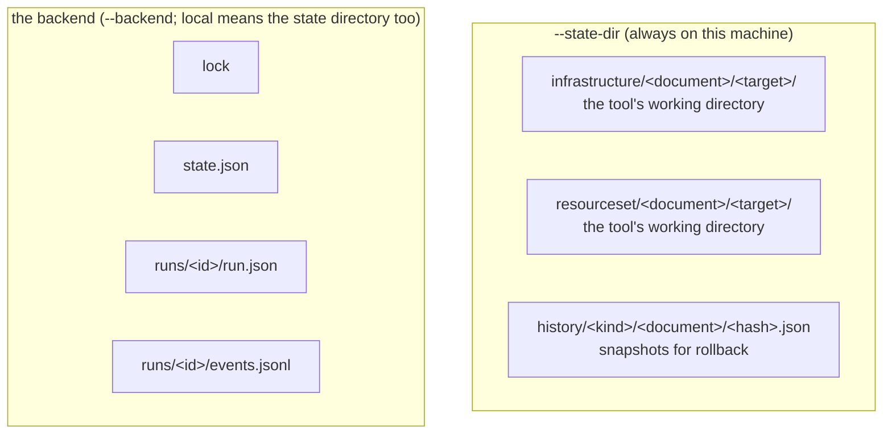
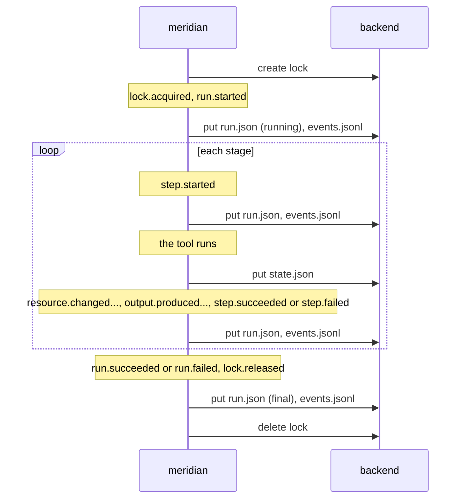

# State, runs and backends

What Meridian keeps about its own runs, where, and in what form. The reasons
are in [running safely](../concepts/run-safety.md).

## What is kept, and where



| Key | Holds | Written |
|---|---|---|
| `lock` | who holds the state, and for what | when a `plan`, `apply`, `drift` or `rollback` starts; removed when it ends |
| `state.json` | the last apply of every stage | after every apply, successful or not |
| `runs/<id>/run.json` | one run's summary | when the run starts, and at every step boundary |
| `runs/<id>/events.jsonl` | one run's events, in order | with `run.json` |

A working directory belongs to the plugin. Meridian creates it, hands it to
the plugin, keeps it between runs, and never reads it.

With the local backend, files are written beside the target and renamed over
it, so a crash never leaves half a file, and are readable only by their owner
(mode `0600`).

**No secret value is kept in the record, in any form.** The record holds
names, ids, hashes of artifacts, counts and times. It does not hold a param,
an output's value, a data file, or anything a tool printed.

## `history/`

A [rollback](../concepts/run-safety.md#putting-a-run-back) applies the
artifact of a stage's last successful apply, so that artifact is kept:
`history/<kind>/<document>/<hash>.json`, a JSON object of the artifact's
files by path. Two are kept per stage, the one just applied and the last good
one before it.

Unlike the record, a snapshot holds content: an artifact contains whatever
its document contains. It is therefore kept **only in the state directory, on
the machine that applied**, readable only by its owner, beside the working
directory where the plugin has already written the same files. It is never
sent to a backend. A machine without the snapshot cannot roll that stage
back, and says so.

A snapshot is loaded by its hash and checked against it. One that has been
changed is refused.

## `lock`

```json
{"command":"apply site.yaml","host":"build-07","id":"2026-11-17T09-14-03Z-0cc7","pid":4242,"since":"2026-11-17T09:14:03.204Z","user":"mike"}
```

| Field | Value |
|---|---|
| `id` | the id of the run that took it; what `meridian unlock` is given |
| `user`, `host`, `pid` | best effort: the operating system user, the machine's name and the process. They identify nobody and authenticate nothing |
| `command` | what the run is doing: the subcommand, the files and the selector |
| `since` | when it was taken |

The lock is created with the backend's one atomic operation, "create only if
absent", so of two runs exactly one gets it. A lock that cannot be read is
still a lock.

## `state.json`

One entry per stage, keyed by the document's kind and name:

```json
{
  "infrastructure/network": {
    "artifactHash": "sha256:9f2c...",
    "lastGood": "sha256:9f2c...",
    "run": "2026-11-17T09-14-03Z-0cc7",
    "status": "applied",
    "target": "terraform"
  },
  "resourceset/web": {
    "artifactHash": "sha256:41d0...",
    "lastGood": "sha256:77aa...",
    "run": "2026-11-17T09-14-03Z-0cc7",
    "status": "failed",
    "target": "ansible"
  }
}
```

| Field | Value |
|---|---|
| `target` | the target the document selected |
| `artifactHash` | the hash of the artifact that was applied, or that the apply was attempted with |
| `status` | `applied` or `failed` |
| `run` | the run that did it |
| `lastGood` | the artifact hash of the last apply that succeeded; equal to `artifactHash` after a success, unchanged by a failure, empty when no apply ever succeeded |

An artifact's hash covers the path and content of every file in it, so the
same documents and data always give the same hash, and anyone can recompile
and compare.

## `runs/<id>/run.json`

```json
{
  "id": "2026-11-17T09-14-03Z-0cc7",
  "mode": "apply",
  "command": "apply site.yaml",
  "user": "mike",
  "host": "build-07",
  "selector": "",
  "started": "2026-11-17T09:14:03.204Z",
  "finished": "2026-11-17T09:15:11.910Z",
  "status": "failed",
  "resumes": "",
  "steps": [
    {"kind": "Infrastructure", "name": "network", "target": "terraform", "endpoint": "",
     "status": "succeeded", "artifact": "sha256:9f2c...", "changes": 4, "reason": "",
     "previous": "sha256:1b7e..."},
    {"kind": "ResourceSet", "name": "web", "target": "ansible", "endpoint": "203.0.113.10",
     "status": "failed", "artifact": "sha256:41d0...", "changes": 2, "reason": "tool-failed",
     "previous": "sha256:77aa..."}
  ]
}
```

| Field | Value |
|---|---|
| `id` | the run's id: the second it started, and four characters that order and separate runs within that second |
| `mode` | `plan`, `apply`, `drift` or `rollback` |
| `status` | `running`, `succeeded` or `failed`. A run that was stopped with Ctrl-C or by a time limit is `failed`, with a step whose `reason` says which; a run that was killed stays `running` |
| `resumes` | the run this one continued, when it was started with `--resume` |
| `selector` | the `-l` selection, when there was one |

A step's `previous` is the artifact hash of its last successful apply before
this run: what a rollback of the run goes back to. It is empty when there was
none.

A step's `status`:

| Status | Meaning |
|---|---|
| `running` | the step had started when the record was last written |
| `succeeded` | it did what was asked: planned, applied, or checked for drift |
| `failed` | it failed; `reason` says what kind of failure |
| `skipped` | a resumed run found it already applied from the same artifact |
| `deferred` | it waits on an output that does not exist yet |
| `not-run` | an earlier step failed, so it was not attempted |
| `rolled-back` | it was applied again from the artifact of its last successful apply; `artifact` is that artifact's hash |

A step's `reason`, when it failed:

| Reason | Meaning |
|---|---|
| `no-plugin` | no plugin provides the document's target |
| `compile-refused` | the document was refused before or while it was compiled |
| `not-supported` | the target cannot do what was asked, such as apply |
| `plugin-failed` | the plugin itself failed: its process died, or the call did |
| `tool-failed` | the tool said no: it exited non-zero, or could not reach the machine |
| `state-failed` | the step's working directory could not be prepared |
| `policy-denied` | the run's [policy](policy.md) does not allow the change, or could not be asked |
| `interrupted` | the operator stopped the run with Ctrl-C (or a `SIGTERM`) while the step was going, or before its tool was started |
| `timed-out` | the step's tool ran past `--stage-timeout` and was stopped |

These words are fixed: a new kind of failure gets a new word, and a word is
never reused. They are also listed with every other error code in
[error kinds and codes](errors.md#stages-of-a-run-meridian-orchestrator).

## Events

`runs/<id>/events.jsonl` has one JSON object per line.

```json
{"attempt":1,"detail":{"artifact":"sha256:41d0...","changes":2,"kind":"ResourceSet","reason":"tool-failed"},"endpoint":"203.0.113.10","instance":"web","run":"2026-11-17T09-14-03Z-0cc7","seq":14,"step":"web","target":"ansible","time":"2026-11-17T09:15:11.204Z","type":"step.failed","workflow":""}
```

| Field | Value |
|---|---|
| `run` | the run |
| `seq` | the event's place in the run, from 1, strictly increasing |
| `time` | when, in UTC |
| `type` | what happened; the table below |
| `step` | the document's name; empty for an event about the run as a whole |
| `instance` | the same as `step` today |
| `endpoint` | the machine the step configures, when there is one |
| `target` | the step's target |
| `attempt` | `1` for a step's event, `0` for the run's |
| `workflow` | empty today |
| `detail` | what else there is to say; fixed per type |

`workflow`, `instance` and `attempt` are in the envelope now so that it does
not change when workflows, fan-out and retries arrive.

| Type | When | `detail` |
|---|---|---|
| `lock.acquired` | the run holds the lock | `id` |
| `run.started` | the run begins | `mode`, `command`, `resumes`, `rollsBack` (the run a `rollback` puts back) |
| `step.started` | a step begins | `kind` |
| `resource.planned` | one line of a plan, or of a drift check | `kind`, `resource`, `action` |
| `resource.changed` | one thing an apply or a rollback changed, including what a failed apply had done before it failed | `kind`, `resource`, `action` |
| `output.produced` | an apply produced an output | `kind`, `name`, `sensitive`. Never the value |
| `policy.passed` | the run's [policy](policy.md) allowed the step | `kind`, `denials` (0), `warnings`, `asked`. Counts, never the messages |
| `policy.denied` | the policy denied the step, or could not be asked | `kind`, `denials`, `warnings`, `asked`: `false` when the engine could not be asked |
| `step.succeeded` | the step did what was asked | `kind`, `artifact`, `changes`; a plan also has `unknown` |
| `step.failed` | the step failed | `kind`, `reason`, `artifact`, `changes` |
| `step.skipped` | the step was not run | `kind`, `reason`: `already-applied` (with `artifact`, `appliedIn`) `earlier-step-failed` (with `becauseOf`), or `when-false`: the document's own `spec.when` left it out. The condition is not recorded |
| `step.deferred` | the step waits on an output | `kind`, `waitingOn`, `output` |
| `drift.none` | a drift check found the step in sync | `kind`, `artifact`, `changes` (0) |
| `drift.detected` | a drift check found the step drifted | `kind`, `artifact`, `changes` |
| `drift.unknown` | a drift check could not call it either way | `kind`, `artifact`, `changes`, `reason`: `never-applied`, `no-preview`, `document-changed` or `last-apply-failed` |
| `rollback.started` | a step is about to be put back | `kind`, `to` (the artifact hash) |
| `rollback.succeeded` | it was put back | `kind`, `to`, `changes` |
| `rollback.failed` | putting it back failed; the rollback stops | `kind`, `to`, `reason` |
| `rollback.unavailable` | it could not be put back, and was left | `kind`, `reason`: `first-apply`, `no-snapshot`, `applied-since`, `document-missing`, `host-unknown`, `imports-unknown`, `no-plugin`, `state-failed` or `earlier-rollback-failed` |
| `run.succeeded`, `run.failed` | the run ends | `steps`, `failed`, `rolledBack` |
| `lock.released` | the run is about to release the lock | `id` |

`action` is `create`, `update`, `delete` or `replace`. `resource` is the id
the tool reported, which is the document's id where the tool's report can be
traced back to one.



The events are written whole at each step boundary, not appended line by
line, because a store of blobs has no append. A run that dies keeps its
events up to the last boundary.

## Choosing a backend

| Option | Environment | Default | Meaning |
|---|---|---|---|
| `--backend NAME` | `MERIDIAN_BACKEND` | `local` | `local`, or the name of a backend program |
| `--backend-config KEY=VALUE` | | | a setting for the backend; may be repeated |
| `--state-dir DIR` | `MERIDIAN_STATE_DIR` | `.meridian` | the working directories, and with `local` the record too |

Every command that reads or writes the record takes these: `plan`, `apply`,
`drift`, `rollback`, `status`, `runs`, `events` and `unlock`.

## Writing a backend

A backend is a program named `meridian-backend-<name>`, in a directory
Meridian looks for plugins in. Meridian runs it once per operation.

| Arguments | Standard input | Standard output | Exit status |
|---|---|---|---|
| `get <key>` | | the blob | `0`, or `3` when there is none |
| `put <key>` | the blob | | `0` |
| `create <key>` | the blob | | `0`, or `4` when the key is already there |
| `delete <key>` | | | `0`, also when there was none |
| `list <prefix>` | | the keys that start with the prefix, one per line | `0` |

- Any other exit status is a failure. What the program wrote to standard
  error is shown as the reason.
- Each `--backend-config KEY=VALUE` arrives as the environment variable
  `MERIDIAN_BACKEND_<KEY>`, in upper case, with anything that is not a letter
  or a digit turned into `_`.
- A key is a relative path with `/` between its parts, such as
  `runs/2026-11-17T09-14-03Z-0cc7/run.json`. Meridian never sends one that
  climbs out of the store, and a backend should refuse one anyway.
- `put` replaces the blob whole. A reader must see the old blob or the new
  one, never part of each.
- **`create` must be atomic.** Of two callers, exactly one may be told `0`.
  The lock stands on this and on nothing else. Use what your store gives you
  for it: `O_EXCL` on a file system, `If-None-Match: *` on an object store
  that supports conditional writes, a conditional put on a key-value store. A
  store with no such operation cannot hold a lock, and should not be used as
  a backend.

The reference implementation is
[`examples/backends/meridian-backend-dir`](../../examples/backends/meridian-backend-dir),
a shell script that keeps the record in a directory. The test suite runs the
same contract against it and against the built-in backend, and runs a whole
apply, a refusal on its lock, and a resume through it.

A backend receives nothing secret from Meridian, but its own settings may be
credentials. They are passed in the environment, are not written to the
record, and are left out of the `command` in the lock and the run.
