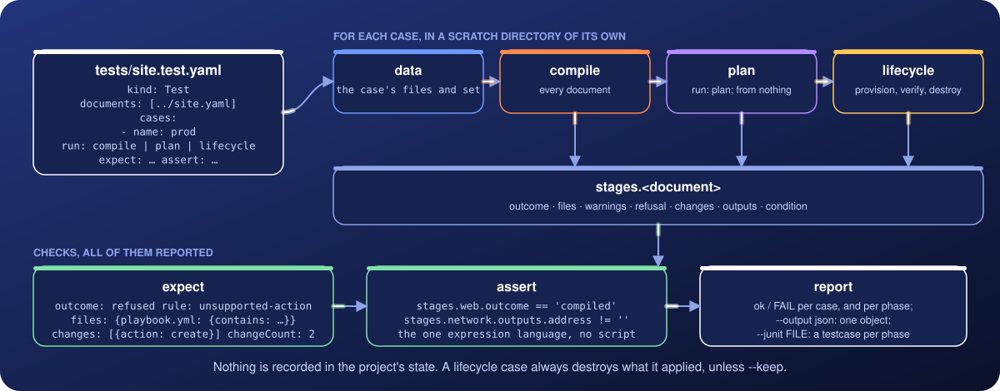

# Testing documents and modules

`meridian test` runs the tests a person writes for their own documents and
modules. A test is a document of `kind: Test`: it names the documents under
test and a list of cases, and each case gives the data the documents are
compiled or planned with and says what should come out. Which document
compiles and which is refused, and under which rule; what an emitted file
holds; what a plan would change. The checks are fields of the document plus
expressions in the [one expression language](dsl/expressions.md), so a test is
a document, not a script.

<p align="center"></p>

**What it does**

- Compiles the documents a test names with the data each case gives, through
  the same plugins `meridian compile` uses, and checks the outcome of each
  document, the files it compiled to, its warnings, and the rule and resource
  of a refusal.
- Plans them, when a case asks, from a scratch state that starts empty, and
  checks the changes each tool reports.
- Evaluates assertions written as expressions over what came out.
- Reports every failure of every case, not only the first, as text, as one
  JSON object with `--output json`, and as JUnit XML with `--junit`.
- Finds `tests/*.test.yaml` on its own, so a module can carry its tests.

**What it does not do**

- It does not apply. A case that needs something disposable to apply to, run
  checks on and tear down is a third level that is not built; the issue that
  tracks it is linked at the end.
- A plan case does not run without the document's tool. The plugin asks the
  tool as `meridian plan` does; a project's [plugin settings](plugin-settings.md)
  can point the plugin at a stand-in.
- It is not a scripting language. A case says what should be true; it cannot
  loop, call out, or change a document on the way.

## Contents

- [A first test](#a-first-test)
- [The Test document](#the-test-document)
- [Cases](#cases)
- [Expectations](#expectations)
- [Assertions](#assertions)
- [What `stages` holds](#what-stages-holds)
- [Running tests](#running-tests)
- [Tests in a module](#tests-in-a-module)
- [In a pipeline](#in-a-pipeline)
- [What is not here yet](#what-is-not-here-yet)

## A first test

A project has a document and a data file:

```yaml
# site.yaml
apiVersion: meridian/v1
kind: ResourceSet
metadata:
  name: web
spec:
  target: ansible
  when: data.web
  targetHost:
    from: inline
    host: web01.example.com
  resources:
    - id: nginx
      type: package
      params:
        name: nginx
    - id: motd
      type: file
      params:
        path: /etc/motd
        content: "${{ data.motd }}"
```

The test sits beside it under `tests/`:

```yaml
# tests/site.test.yaml
apiVersion: meridian/v1
kind: Test
metadata:
  name: site
spec:
  documents: [../site.yaml]
  set:
    web: true
    motd: "welcome to ${{ data.env }}"
    env: dev
  cases:
    - name: dev compiles nginx and the message
      expect:
        web:
          outcome: compiled
          files:
            playbook.yml:
              contains: ["name: nginx", "welcome to dev"]
      assert:
        - length(keys(stages.web.files)) == 1
    - name: production says so
      set: {env: prod}
      assert:
        - contains(stages.web.files['playbook.yml'], 'welcome to prod')
    - name: a site with no web tier compiles nothing
      set: {web: false}
      expect:
        web: {outcome: left-out}
```

```
$ meridian test
tests/site.test.yaml (site)
  ok    dev compiles nginx and the message (compile, 1 document)
  ok    production says so (compile, 1 document)
  ok    a site with no web tier compiles nothing (compile, 1 document)
3 cases: 3 passed
```

A case that fails says what it found:

```
tests/site.test.yaml (site)
  FAIL  dev compiles nginx and the message (compile, 1 document)
        - document "web": file "playbook.yml" does not contain "welcome to dev"
        - assert length(keys(stages.web.files)) == 1: false
1 case: 1 failed
```

## The Test document

| Field | Required | Value |
|---|---|---|
| `apiVersion` | yes | `meridian/v1` |
| `kind` | yes | `Test` |
| `metadata.name` | yes | The test's name, shown in the report and used as the JUnit suite name |
| `metadata.description` | no | One line on what the test covers |
| `spec.documents` | yes | The documents under test: one path or a list, relative to the test file, or a [module file](modules.md#using-a-modules-files) written `@acme/nginx:documents/proxy.yaml`. Every case loads all of them, as one `meridian compile` of the same files would |
| `spec.data` | no | Data files read for every case, as `--data` reads them, relative to the test file |
| `spec.set` | no | A mapping merged over the data for every case. A mapping inside a mapping is merged key by key; anything else replaces what was there, as `--set a.b=1` does |
| `spec.select` | no | A [label selector](cli.md#running-part-of-a-workflow), as `-l` takes it, that every case runs under |
| `spec.cases` | yes | The cases, at least one, each with a name no other case has |

A `Test` document is read only by `meridian test`. `meridian lint`,
`meridian fmt` and the language server leave a file whose kind is `Test`
alone, as they do a module's manifest, and `meridian compile` refuses it as
a document of a kind it does not compile. A file named `*.test.yaml` is also
what `meridian test` looks for when it is given no files.

## Cases

Each entry of `spec.cases` is one run of the documents with its own data,
followed by its checks.

| Field | Required | Value |
|---|---|---|
| `name` | yes | What the case checks, in a few words. Unique within the test |
| `run` | no | `compile` (the default) or `plan`. See [levels](#levels) |
| `data` | no | Data files read after the test's `spec.data` |
| `set` | no | Values merged over the data after the test's `spec.set` |
| `select` | no | A label selector that replaces the test's `spec.select` for this case |
| `expect` | one of the two | What each document should have come to, by the document's `metadata.name`. See [expectations](#expectations) |
| `assert` | one of the two | Expressions that must each be true. See [assertions](#assertions) |

A case must expect or assert something: a case that checks nothing cannot
fail, so it is refused when the file is read. Every field is checked before
the first case runs, so a mistake in the last case is reported before the
first one has taken its time.

### Levels

A **compile** case does what `meridian compile` does: reads the documents,
decides their conditions against the case's data, compiles each selected
document through its plugin, and keeps the files, the warnings and the
refusals. No tool runs and nothing is contacted, so a compile case needs only
the plugins, exactly as `compile` does.

A **plan** case goes one step further: each compiled document's tool is asked
what applying would change, as `meridian plan` asks it. The plan runs in a
scratch directory of the case's own under `tests/` in the state directory,
emptied before the case starts, so nothing has been applied there and nothing
the case does reaches the project's own state or record. A tool that keeps its
own state elsewhere, such as Terraform with a remote backend, plans against
that; a tool that keeps it in the working directory, such as the stand-in
targets of the test kit, plans against nothing. A document that waits for an
output of an Infrastructure document that has not been applied is
`deferred`, as it is in a plan.

A plan case needs the document's tool on the machine, or a stand-in: the
project's [plugin settings](plugin-settings.md) say which program each plugin
runs, so a `meridian.yaml` in the test's directory can name one.

## Expectations

`expect` is a mapping from a document's name to what it should have come to.
A name that no document of the case has is a failure, and so is each
expectation that does not hold; all of them are reported.

| Field | Checks |
|---|---|
| `outcome` | The document's outcome is this word: `compiled`, `refused`, `left-out` (its own `spec.when` was false), `planned`, `deferred` (a plan case waiting for an output), or `failed` (the plugin or the tool failed) |
| `rule` | The document was refused, and the refusal carries this [rule](refusal-rules.md) |
| `resource` | The refusal names this resource |
| `message` | The refusal's message holds this text |
| `files` | What the files the document compiled to hold, by the path the plugin gives each. Each file takes `contains` (text, or a list of texts, each of which must appear), `notContains`, `equals` (the whole file, exactly) and `matches` (a [pattern](dsl/expressions.md#patterns), or a list; the same patterns as `regexMatch`) |
| `warnings` | Text, or a list of texts, each of which some warning of the compile holds |
| `changes` | In a plan case, changes that must be among the tool's: each names an `action` (`create`, `update`, `delete`, `replace`), a `resource` (the id, or the tool's own name for what changes, as `meridian plan` prints it), or both |
| `changeCount` | In a plan case, exactly how many changes the tool reports. A tool that cannot preview fails this |

A document that exists only to be refused is still an error to
`meridian lint` run over its directory, which cannot know a test wants it
that way. Where you can, make the refusal come from the case's data instead,
as the [example](../../examples/tests/tests/web.test.yaml) does with a file
mode written as a number: the document is sound, and one case gives it a
value its target refuses.

A refusal's rule and resource are the ones `meridian compile` prints, and
the names are the same on every target: `unsupported-resource-type` is
`unsupported-resource-type` on Ansible and on Puppet. The
[refusal rules](refusal-rules.md) page lists every rule.

## Assertions

`assert` is a list of expressions, each of which must be true. An entry is
the expression as text, or a mapping of `expr` and a `message` to show
instead of the expression when it is false:

```yaml
assert:
  - stages.web.outcome == 'compiled'
  - expr: contains(stages.web.files['playbook.yml'], 'become: true')
    message: the playbook must escalate
  - all(map(stages.network.changes, 'c', c.action == 'create'))
```

An assertion is written in the expression language of `when` and
`${{ }}`, with the same functions and the same errors, and is checked when
the file is read: a name it cannot read or a function that does not exist is
refused before anything runs. It can read two names:

- `stages`: a mapping from each document's name to what it came to; see
  [below](#what-stages-holds).
- `data`: the data the case ran with, after its files and its `set`.

An expression that is not a boolean is an error, not a failure to be read as
false: `stages.web.outcome` on its own is refused, `stages.web.outcome ==
'compiled'` is a check. A path that is not set, such as a document the case
does not have, is an error too, with the hint that `defined()` tests for it.

## What `stages` holds

`stages.<name>` is a mapping with these fields, for each document the case
ran, including one left out by its condition:

| Field | Value |
|---|---|
| `name`, `kind`, `target` | The document's name, `Infrastructure` or `ResourceSet`, and its target |
| `outcome` | The word the table above lists, plus `not-run` for a document after one that failed |
| `files` | The emitted files by path, each as its text; `{}` when the document was not compiled |
| `warnings` | The compile's warnings, each as one line of text |
| `refusal` | `null`, or a mapping of `rule`, `resource` and `message` for a refused document. A refusal the orchestrator makes itself, such as a `ResourceSet` sent to an infrastructure target, carries no rule and an empty `resource` |
| `changes` | In a plan case, the tool's changes, each with `action`, `resource` and `summary`; `[]` otherwise |
| `unknown` | Whether the tool could not preview, so `changes` says nothing |
| `condition` | The `when` that left the document out, or `null` |
| `error` | The failure's text when the document failed or was refused, or `null` |

A secret never reaches a test: a document whose conditions read a secret
cannot be compiled by `compile`, and so cannot be compiled by a case either.
It is reported as refused, for exactly that reason, as `compile` reports it.

## Running tests

```
meridian test                          # every tests/*.test.yaml
meridian test tests/site.test.yaml     # these files
meridian test --case prod              # only the cases whose name holds "prod"
meridian test --junit report.xml       # also write JUnit XML
meridian test --output json            # one object, for a machine
```

Every case of every file runs, whatever an earlier one did: a failing case
does not stop the next. The command exits `0` when every case passed and `1`
otherwise, including when a test file does not read, when no test file was
found, or when `--case` matched nothing. The plugins are found as they are
for every other command: `--plugin-dir`, `MERIDIAN_PLUGIN_DIR`, and the
directory `meridian` is in.

Each case is one line: `ok`, `FAIL` or `ERR`, the case's name, its level and
how many documents it ran; a failed case is followed by one line per failure.
`ERR` is a case that could not run at all: a document that does not load, a
data file that does not read, a run that was refused. The last line counts the
cases.

`--output json` prints [one object](cli-json.md#test) with every file, every
case, its status and its failures. `--junit FILE` writes the same as JUnit
XML, one `testsuite` per test document and one `testcase` per case, which
every pipeline engine shows as tests.

## Tests in a module

A [module](modules.md) carries its tests the way it carries its documents:

```
acme-nginx/
  meridian.yaml
  documents/proxy.yaml
  data/defaults.yaml
  tests/proxy.test.yaml
```

The test names the module's own files relative to itself
(`../documents/proxy.yaml`, `../data/defaults.yaml`), so `meridian test` run
in the module's directory tests the module as it is, before it is tagged,
signed or pushed. A project that uses the module can test it as it arrives,
by naming the module's files the way any command does:

```yaml
spec:
  documents: ["@acme/nginx:documents/proxy.yaml"]
  data: ["@acme/nginx:data/defaults.yaml"]
```

`meridian module install` fetches no tests and runs none: a module's tests
are run by whoever decides to, never on install.

## In a pipeline

In a [pipeline engine](../operations/running-in-a-pipeline.md), run the tests
before the plan, and hand the engine the JUnit file:

```yaml
- run: meridian test --junit meridian-tests.xml
- uses: dorny/test-reporter@v1
  if: always()
  with:
    name: meridian tests
    path: meridian-tests.xml
    reporter: java-junit
```

The compile cases need nothing but the plugins, so they run on any runner. A
plan case needs its tool, as the plan job does.

## What is not here yet

- **Apply cases.** Applying to something disposable (a container for a
  configuration management target, a `kind` cluster for Kubernetes, the real
  cloud when asked), running checks on what was applied, and tearing it down.
  It waits on a `destroy` operation in the plugin protocol
  ([issue 127](https://github.com/ZanattaMichael/meridian-core/issues/127))
  and on the disposable machines of
  [issue 123](https://github.com/ZanattaMichael/meridian-core/issues/123).
- **Expectations on events and outputs.** A compile or plan case has no
  outputs to check yet; an apply case would.
- **A line number for a mistake in a test file.** A problem is named by its
  path in the document (`spec.cases[2].expect.web.outcome`), not yet by its
  line.

The design choices are recorded in
[decision 0035](../decisions/0035-a-test-is-a-document-of-cases-over-compile-and-plan.md).
