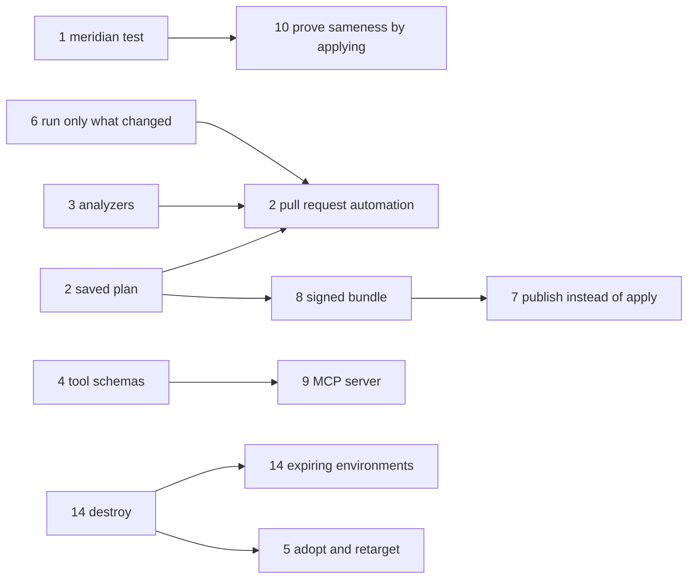

# Ideas to improve Meridian: a ranked research report

Written on 2026-11-17 from a review of the repository at commit `8733fff` and of what
comparable tools do. This is research, not an accepted plan. Nothing here is built, and
nothing here is decided: each idea that the owner takes up should become a plan under
[`docs/plans/`](../plans/README.md) or an issue of its own.

## What this report covers, and what it leaves out

The report looks for **new capabilities and direction**. It deliberately leaves out:

- **Bugs and improvements to existing code.** Those are filed as issues by separate
  reviews.
- **What is already planned.** The [language expansion](../plans/language-expansion.md)
  already covers `forEach`, templates, typed parameters, layered `Data`, composites,
  inventories and endpoints, credentials, the `Workflow` document with gates and rolling
  strategies, notification sinks, secret provider plugins and facts. Run safety, policy
  checks, modules, signing, import, reporting and the editor tools are built or in
  review. Where an idea below leans on one of those, it says so.
- **Which further tools to support.** An earlier report covered that (OpenTofu, OpenVox,
  Helm, Pulumi, Packer, Podman, Salt and others, most of which now exist as plugins).

## How the ideas are ranked

Each idea is scored on three things, and the ranking is the judgement that follows from
them, not a formula.

- **Value**: how much it changes what a person or a team can do with Meridian.
- **Fit**: whether it follows from what Meridian already is (a compiler that emits each
  tool's native files, refuses what it cannot express, and records every run as events),
  or whether it would turn Meridian into a different kind of product.
- **Effort**: S is days, M is one to three weeks, L is one to two months, XL is a
  quarter or more, for one person who knows the codebase.

## Summary

| Rank | Idea | Value | Fit | Effort |
|---|---|---|---|---|
| 1 | [`meridian test`: tests for documents](#1-meridian-test-tests-for-documents) | high | high | M |
| 2 | [A saved plan, and pull request automation built on it](#2-a-saved-plan-and-pull-request-automation-built-on-it) | high | high | M |
| 3 | [Analyzer plugins: security scanners and cost on the compiled files](#3-analyzer-plugins-security-scanners-and-cost-on-the-compiled-files) | high | high | M |
| 4 | [Read each tool's own schemas for native resource types](#4-read-each-tools-own-schemas-for-native-resource-types) | high | high | L |
| 5 | [Adopt what exists, and move between tools](#5-adopt-what-exists-and-move-between-tools) | high | high | L |
| 6 | [Run only what changed](#6-run-only-what-changed) | medium | high | M |
| 7 | [Publish instead of apply: GitOps and pull-mode delivery](#7-publish-instead-of-apply-gitops-and-pull-mode-delivery) | high | medium | M per mode |
| 8 | [Build once, promote: a signed bundle of compiled files](#8-build-once-promote-a-signed-bundle-of-compiled-files) | medium | high | M |
| 9 | [An MCP server, so that AI agents use the compiler instead of guessing](#9-an-mcp-server-so-that-ai-agents-use-the-compiler-instead-of-guessing) | medium | high | S |
| 10 | [Prove "the same on every tool" by applying it](#10-prove-the-same-on-every-tool-by-applying-it) | medium | high | M to L |
| 11 | [Day-two operations](#11-day-two-operations) | medium | medium | M to L |
| 12 | [WebAssembly for the compile half of a plugin, and a browser playground](#12-webassembly-for-the-compile-half-of-a-plugin-and-a-browser-playground) | medium | medium | L |
| 13 | [Pinned, hermetic tools](#13-pinned-hermetic-tools) | medium | medium | M |
| 14 | [A destroy operation, and environments that expire](#14-a-destroy-operation-and-environments-that-expire) | medium | medium | M |
| 15 | [Smaller ideas](#15-smaller-ideas) | low to medium | high | S each |
| | [Looked at and not recommended now](#looked-at-and-not-recommended-now) | | | |

The first three reinforce each other and none needs a change to the language, so they
are the suggested place to start. Idea 4 is the largest single improvement to the
day-to-day experience of writing infrastructure documents. Idea 5 is the one that no
comparable tool can offer.

---

## 1. `meridian test`: tests for documents

**The gap.** Meridian's own test suite is thorough (golden files, a generated
conformance matrix, property tests), but a person who writes documents or publishes a
[module](../reference/modules.md) has no way to test *their* work. They can `validate`,
`lint` and `plan`, and that is all. A module registry without a test command produces
modules nobody can trust.

**Prior art.**

- Terraform has had `terraform test` since 1.6: `.tftest.hcl` files hold `run` blocks
  that plan or apply, with `assert` blocks, and 1.7 added mocked provider data so a test
  needs no cloud account. By default it creates real infrastructure and destroys it at
  the end. OpenTofu's `tofu test` is the same shape, with `mock_provider` and
  `override_*` blocks
  ([Terraform tests](https://developer.hashicorp.com/terraform/language/tests),
  [`tofu test`](https://opentofu.org/docs/cli/commands/test/)).
- Pulumi documents three levels: unit tests with mocks, property tests built on its
  policy engine, and integration tests that deploy and destroy
  ([Pulumi testing](https://www.pulumi.com/docs/iac/concepts/testing/)).
- Configuration management has Molecule (Ansible), Test Kitchen with InSpec (Chef) and
  Goss: converge a container or VM, then assert on the machine.

**What it would be.** A `Test` document, or a `tests/` directory in a module, with
three levels that map onto what Meridian already has:

1. **Compile tests.** Give parameters and data, assert on the compiled graph or on the
   emitted files, or assert that the compile is *refused* with a named rule. This needs
   no tool installed and is the same machinery as the golden-file tests, opened to
   users.
2. **Plan tests.** Run `plan` against a stand-in tool and assert on the list of
   changes. `meridian-plugin-testkit` already has stand-ins for every tool.
3. **Apply tests.** Apply to something disposable (a container for configuration
   management, `kind` for Kubernetes, the real cloud when asked), run checks, and tear
   down. Checks are expressions in the existing expression engine over the stage's
   outputs, plus an `exec` check.

**Feasibility.** Levels 1 and 2 are mostly wiring: the expression engine
(`meridian-expr`), the testkit and the event stream exist, and JUnit output exists in
the reporting work. Level 3 needs somewhere disposable to apply to, which is the work
of [idea 10](#10-prove-the-same-on-every-tool-by-applying-it), and a way to tear down,
which is [idea 14](#14-a-destroy-operation-and-environments-that-expire).

**Effort.** M for levels 1 and 2. Level 3 follows the ideas it depends on.

**Risk.** Inventing a test language. Keep it to documents plus expressions; do not add
a scripting layer.

## 2. A saved plan, and pull request automation built on it

**The gap.** `meridian plan` prints what would change and `meridian apply` plans again
before it applies. Nothing ties the two together, so what a reviewer approved is not
necessarily what is applied: the documents, the data or the world can change in
between. There is also no ready-made way to run Meridian from a pull request, which is
where most teams review infrastructure changes.

**Prior art.**

- Terraform and OpenTofu write a plan file (`plan -out`) and `apply` takes it, refusing
  when state has moved on. Pulumi has the same idea in `preview --save-plan`. The
  OpenTofu and Pulumi plugins already mention their tool's saved plan.
- Atlantis runs plan on a pull request, posts it as a comment, locks the directory and
  applies on approval ([Atlantis docs](https://www.runatlantis.io/docs/)). Digger,
  Terrateam, Spacelift and HCP Terraform all do the same. Every one of them is tied to
  Terraform-shaped tools.

**What it would be.**

- `meridian plan --out plan.mplan` writes one file holding, per stage: the hash of the
  compiled artifact, the change list, the tool's own saved plan where the tool has one
  (Terraform, OpenTofu, Pulumi and CloudFormation change sets do; Bicep's what-if does not),
  and the policy decision. `meridian apply plan.mplan` recompiles, refuses if any
  artifact hash differs, and hands each tool its saved plan. The resume logic already
  compares "documents that still compile to the same artifact", so the comparison
  exists.
- A GitHub Action (and a documented GitLab recipe) that runs `plan`, posts the Markdown
  report as one comment that is updated in place, uploads the plan file, and applies
  that file after merge or approval. The Markdown and JSON report formats from the
  reporting work are the comment body.

**Why this ranks high for Meridian.** A cross-tool plan in one pull request comment
(Terraform changes, then the Ansible changes that depend on them, with the policy
verdict) is something no existing pull request tool produces, because each understands
one tool.

**Feasibility.** The protocol needs an optional "save plan" and "apply saved plan"
pair; plugins without it fall back to comparing artifact hashes and replanning, and the
plan file says which stages are weaker for it. The capability model already has a place
to say so.

**Effort.** M: the plan file and protocol field, three or four plugins, then the
Action, which is small.

## 3. Analyzer plugins: security scanners and cost on the compiled files

**The gap.** Policy checks today are Rego over Meridian's own plan input. The large
existing libraries of security and compliance rules are written against the tools'
native formats, and Meridian's output *is* those formats. Nothing runs them.

**Prior art.**

- Checkov scans Terraform (source, plan and JSON), CloudFormation, Kubernetes, Helm,
  Kustomize, Dockerfiles, Ansible, Bicep, ARM and OpenTofu, and writes SARIF
  ([Checkov](https://github.com/bridgecrewio/checkov)).
- Trivy's misconfiguration scanner covers Terraform, CloudFormation, ARM, Kubernetes,
  Helm and Docker
  ([Trivy](https://trivy.dev/latest/docs/scanner/misconfiguration/)).
- Infracost estimates cost for Terraform, Terragrunt, CloudFormation and AWS CDK; the
  CloudFormation support was announced in December 2025 for its hosted product first
  ([Infracost](https://github.com/infracost/infracost),
  [announcement](https://www.infracost.io/blog/cloudformation-support-is-here/)).
- Spacelift and HCP Terraform both sell "run these checks between plan and apply" as a
  platform feature.

**What it would be.** A new kind of external program beside `meridian-policy-<name>`,
`meridian-backend-<name>` and `meridian-notify-<name>`: `meridian-analyze-<name>`. It
is given the compiled artifact directory and the target name, and returns findings
(rule, severity, file, line, message) and optionally numbers (monthly cost, delta).
Findings become events, so they appear in reports and sinks without new code, and
`--analyze checkov,trivy` can fail a run above a severity. Because the compiler knows the
position of every resource in its document, a finding in `main.tf.json` can be reported **against the line of the Meridian document**, which is the part an
operator can act on.

**Feasibility.** High. The pattern (a named program, a small protocol, fail closed) has
been built three times in this repository. The source-position mapping is the only new
piece: emitters would write a side file mapping output paths to document positions.
This also unblocks SARIF output, which the reporting work is waiting to write.

**Effort.** M for the protocol, the mapping and two reference analyzers.

**Risk.** Scanner findings on generated files can be noisy where Meridian adds
boilerplate. A per-target baseline of known, accepted findings should ship with each
plugin.

## 4. Read each tool's own schemas for native resource types

**The gap.** For the six shared configuration management types, Meridian knows every
param and state, and the editor completes them. For everything else, which is most of
what people write, a resource is
[native passthrough](../concepts/ir-overview.md#two-families-of-types): `type` and
`params` are the tool's own, and Meridian checks little about them. A misspelt
argument on `aws_instance` is found by Terraform at plan time, not by `meridian
validate`, and the editor cannot complete it. The plugin protocol's `ResourceSchema`
already allows a pattern such as `<provider>_<type>` marked `open`, which is an honest
way of saying "we do not know".

**Prior art.** Every one of these tools publishes its types in a machine-readable form:

| Tool | Where the schema is |
|---|---|
| Terraform, OpenTofu | `terraform providers schema -json` |
| Kubernetes, Helm | the cluster's OpenAPI document, and each CRD's schema |
| CloudFormation | the CloudFormation registry's resource type schemas |
| Bicep, ARM | the published Azure resource type definitions |
| Pulumi | each package's `schema.json` |
| Ansible | `ansible-doc --json` |
| DSC | `Get-DscResource`, and resource manifests in DSC v3 |

Pulumi's bridge and Crossplane's Upjet both generate whole providers from Terraform
provider schemas, which shows the schemas are complete enough to build on. The
Terraform language server uses the same JSON for its completion.

**What it would be.** An optional plugin operation, `Schemas`, that asks the installed
tool for the types a document uses and returns them in the existing `ResourceSchema`
shape (extended with nested blocks and computed attributes). The core caches the
answer by tool and provider version under the state directory. With it:

- `validate` and `lint` catch unknown params, wrong kinds and missing required params
  for native types, with the document's line number, with no tool run.
- The language server completes and documents native params.
- `${id.path}` references can be checked against the attributes a resource actually
  exports, where today only the id is checked.
- Import becomes more exact, since it knows which attributes are computed.

**Feasibility.** Good for Terraform, OpenTofu, Kubernetes and Pulumi, where the schema
is one command or one file. Moderate for Azure and CloudFormation, where the schemas
are large and need to be fetched and cached. It must stay advice that tightens over
time: a missing schema (air-gapped machine, tool not installed) leaves today's
behaviour, never a refusal.

**Effort.** L overall; M for Terraform, OpenTofu and Kubernetes alone, which is the
sensible first slice.

## 5. Adopt what exists, and move between tools

**The gap.** `meridian import` turns existing *configuration* into documents. It does
not bring existing *resources* under management, and nothing helps a team move a
workload from one tool to another, although Meridian is the only tool positioned to do
it: the same document already compiles for several targets.

**Prior art.**

- Terraform and OpenTofu have `import` blocks and generated configuration; Terraform
  1.14 lists a search-and-import workflow in its language documentation. Pulumi has
  `pulumi import`, CloudFormation has resource import and its IaC generator, and Azure
  can export a resource group as a template.
- No tool moves state *between* tools. Teams that move from Puppet to Ansible, from
  Terraform to OpenTofu, from ARM to Bicep or from Compose to Kubernetes do it by hand.

**What it would be.**

1. **`spec.adopt`.** A resource can say "this already exists, as this identifier". The
   Terraform and OpenTofu plugins compile it to an `import` block, Pulumi to an import
   option, CloudFormation to a resource-import change set. Targets that keep no state
   (Ansible, Puppet, Chef, Salt, DSC) need nothing, and say so.
2. **`meridian retarget`.** Compile the document for the new target, show a table of
   what the new target refuses or does differently (the capability model already
   produces this), and for stateful tools generate the `adopt` entries from the old
   tool's outputs and state so the first plan on the new tool is empty. Terraform to
   OpenTofu, ARM to Bicep and Puppet to OpenVox are near-trivial and useful
   demonstrations; Puppet to Ansible is the one people will pay attention to.

**Feasibility.** `adopt` is ordinary plugin work. `retarget` between tools in the same
family is realistic because both ends share resource types. Across families (Terraform
to CloudFormation) the types differ and Meridian has no mapping, so that should be
stated as out of scope, not promised.

**Effort.** L. `adopt` alone is M and is worth having on its own.

**Why it matters for direction.** It turns "one language for many tools" from a
convenience into a way out of lock-in, which is the strongest argument Meridian has
against "why not just use the tool directly".

## 6. Run only what changed

**The gap.** A run plans every document it is given. In a repository with fifty
documents, a one-line change plans fifty stages, takes the lock for all of them and
starts every tool.

**Prior art.** Terramate's `--changed` runs only the stacks that a Git comparison
touches, and can widen that to the stacks that depend on them through shared outputs
([Terramate change detection](https://terramate.io/docs/cli/change-detection/)).
Terragrunt, Nx, Turborepo and Bazel have the same idea. Nix and Bazel go further and
key work on the hash of its inputs, not on files.

**What it would be.** `--changed-since <git ref>` on `plan`, `apply` and `drift`.
Meridian can be more exact than a file comparison, because it compiles: compile every
document at the old ref and at the new one (compiling is free of side effects and
deterministic), compare the artifact hashes, select the stages whose artifact differs,
and add the stages that import their outputs. A change to a comment or to a data key
that a document does not read selects nothing. The run record already stores artifact
hashes, so "changed since the last successful apply" is available with no Git at all.

**Feasibility.** High. The selection options (`--step`, labels) and the dependency
order exist. The new part is a compile at another revision, which is a checkout into a
temporary directory.

**Effort.** M.

## 7. Publish instead of apply: GitOps and pull-mode delivery

**The gap.** Every runner today pushes: it runs `kubectl apply`, `ansible-playbook`,
`puppet apply`. Many estates do not work that way. Kubernetes shops let Argo CD or Flux
pull from Git; Puppet and Chef estates pull from a server; Windows estates pull DSC
from Azure Machine Configuration. In those estates Meridian's compile half is welcome
and its apply half is not allowed.

**Prior art.**

- The **rendered manifests pattern**: render Helm or Kustomize before the cluster and
  commit the plain YAML, so that the diff a reviewer sees is the real one. Argo CD's
  source hydrator does this natively, pushing rendered output to a branch it then
  syncs; its documentation marks it beta since Argo CD 3.5
  ([source hydrator](https://argo-cd.readthedocs.io/en/stable/user-guide/source-hydrator/),
  [the pattern](https://akuity.io/blog/the-rendered-manifests-pattern)).
- Flux pulls manifests from an OCI registry through `OCIRepository` and can verify a
  cosign signature first
  ([Flux OCI artifacts](https://fluxcd.io/flux/cheatsheets/oci-artifacts/)).
- `ansible-pull`, Puppet's code deployment (r10k), Chef policyfiles pushed to a Chef
  server and Azure Machine Configuration packages are the same idea for hosts.

**What it would be.** A second way to finish a stage, chosen per document or per
workflow step: `deliver: publish`. `plan` shows the difference between what is
published and what would be; `apply` publishes (commits to a branch, pushes an OCI
artifact, uploads a package) and reports the published revision as an output. Meridian
is already a rendered-manifests generator; this makes it one deliberately. Drift for a
published stage asks "is what is published what I compiled", which is exact.

**Feasibility.** Git and OCI publishing are generic and belong in the core or SDK,
since `meridian-module` already pushes OCI artifacts. Tool servers (Chef server, Azure
Machine Configuration) are per-plugin work and can come one at a time.

**Effort.** M for Git and OCI with the Kubernetes and Helm plugins; then M per further
mode.

**Fit note.** This overlaps with the earlier suggestion to add Argo CD and Flux as
*targets*. Treating them as a *delivery mode* is smaller and keeps their configuration
out of the language.

## 8. Build once, promote: a signed bundle of compiled files

**The gap.** Each environment is compiled where and when it is applied. Two things
follow: what ran in staging is not provably what runs in production, and an air-gapped
site needs the documents, the modules, the data and the plugins to compile at all.

**Prior art.** Container images set the expectation: build once, sign, promote the
same digest. Kargo promotes rendered manifests between stages; Flux and Crossplane
packages ship configuration as signed OCI artifacts; Zarf does it for air-gapped sites.
SLSA provenance and in-toto attestations, attached with cosign, are the usual way to
record what built an artifact and from what.

**What it would be.** `meridian compile --bundle` writes one content-addressed archive:
every stage's artifact, the dependency order, the hashes of the documents, data and
modules that went in, and the plugin versions. `meridian module sign` already signs
with the keys plugins use, so the bundle is signed the same way, and a provenance
statement is written beside it. `meridian apply --bundle` applies a bundle without the
sources. Parameters that differ per environment are either compiled per environment
into separate bundles from one commit, or left as the tool's own variables, which the
`spec.imports` mechanism already knows how to hand over.

**Feasibility.** High: compile is deterministic by test, and signing, OCI push and
artifact hashing exist. The design question is which values may stay open in a bundle;
secrets must, and must never be written into one.

**Effort.** M. Shares its file format with [idea 2](#2-a-saved-plan-and-pull-request-automation-built-on-it),
so they should be designed together.

## 9. An MCP server, so that AI agents use the compiler instead of guessing

**The gap.** A growing share of infrastructure configuration is drafted by AI coding
agents. A new language is where they are weakest: there is no body of public Meridian
documents to have learned from, so an agent will write plausible, wrong YAML.

**Prior art.** HashiCorp publishes a Terraform MCP server (MPL-2.0) whose default
toolset looks up providers, modules and policies in the registry, with a further
toolset that manages HCP Terraform workspaces and runs
([terraform-mcp-server](https://github.com/hashicorp/terraform-mcp-server)). Pulumi,
AWS and Spacelift publish their own. Infracost now ships editor and agent
integrations for the same reason.

**What it would be.** `meridian mcp`, in the same binary and beside `meridian lsp`,
exposing read-only tools by default: validate, lint, compile to a string, list plugins
and their resource types and params, explain a refusal, show the capability matrix,
format, import a snippet. `plan` only with an explicit flag, and `apply` never by
default. Because the tools are the compiler, an agent's draft is checked by the same
code that will refuse it later, and Meridian's refusals are already written to say
what the target *does* accept, which is exactly the feedback an agent needs.

**Feasibility.** High. `meridian-tooling` already holds everything the language server
serves; this is another front on it. With [idea 4](#4-read-each-tools-own-schemas-for-native-resource-types)
it also answers "what params does this native type take".

**Effort.** S.

**Risk.** The [observability plan](../plans/observability.md#4-telemetry) promises
that Meridian makes no outbound connections. A local MCP server over standard input
keeps that promise; it should not grow a hosted mode.

## 10. Prove "the same on every tool" by applying it

**The gap.** The [conformance matrix](../reference/conformance-matrix.md) proves that
six configuration management targets *compile* the same documents, or refuse them
alike. The real-tool workflows prove each tool accepts its files. Nothing checks that
applying the same document through Ansible and through Puppet leaves a machine in the
same state, which is the claim a user actually relies on.

**Prior art.** Differential testing is how compilers are checked against each other
(Csmith is the well-known example). For machines, Goss, InSpec and Testinfra assert on
packages, files, services, users and ports, and Molecule and Test Kitchen provide the
converge-then-verify loop.

**What it would be.** For each row of the conformance matrix marked *same*: start one
container per target from the same image, apply the row's document with the real tool,
then collect a normalised snapshot (package versions, file content hashes with mode and
owner, service state, users and groups) and compare the snapshots across targets. A
difference is either a plugin bug or a row that must be marked *no* with the reason
written down. The result is a generated page, like the matrix.

**Feasibility.** The real-tool workflows already install every tool on a runner. The
work is the snapshot collector (one small script, run in each container) and systemd
inside containers for service rows. It runs in CI only, since tools cannot be
installed in a development sandbox.

**Effort.** M for packages, files, users and groups; L with services.

**Why bother.** It would have a high chance of finding real differences (default file
modes, service enablement, package version pinning), and the generated page is
evidence no competitor can show, because no competitor compiles to six tools.

## 11. Day-two operations

**The gap.** Everything Meridian does converges state. Restarting a service now,
rotating a certificate, failing over a database, taking a backup before an upgrade are
operations, not states, and a team that adopts Meridian still needs a second tool for
them. The escape hatch today is an `exec` resource, which runs on every apply.

**Prior art.**

- Terraform added `action` blocks: operations built into providers for day-two work,
  such as running an Ansible playbook or invoking a function, started from a
  resource's lifecycle events or from the command line with `-invoke`, and never part
  of state ([invoke actions](https://developer.hashicorp.com/terraform/language/v1.14.x/invoke-actions),
  [`action` block](https://developer.hashicorp.com/terraform/language/v1.14.x/block/action)).
- Crossplane 2.0 (August 2025) added `Operation`, with scheduled and event-driven
  forms, for the same reason
  ([announcement](https://blog.crossplane.io/announcing-crossplane-2-0/)).
- Ansible ad-hoc commands, AWX job templates, Rundeck jobs, Salt's remote execution and
  Bolt tasks are the long-standing versions.

Two declarative-only projects adding operations within a few months of each other is
the signal worth noting.

**What it would be.** An `Operation` document: named, with typed parameters, run on
endpoints, never part of an apply unless a workflow step names it. It compiles to what
each tool already has for this: an Ansible play run once, a Bolt or Salt task, a
`kubectl rollout restart`, a Terraform action. A workflow step can then be
`run: backup-database` before `run: upgrade`. `meridian run <operation>` records the
run like any other, so who ran what and when is answered by the existing run record.

**Feasibility.** It depends on inventories and endpoints (phase 6 of the language
expansion) and fits naturally into the `Workflow` document (phase 8). It needs a new
plugin capability, since several targets have nothing to compile an operation to.

**Effort.** M to L, after those phases.

## 12. WebAssembly for the compile half of a plugin, and a browser playground

**The gap.** A plugin is a native binary per platform, started as a process and
trusted by signature. That is right for the half that runs tools. The compile half is
a pure function from a resource graph to files, and paying for a process, a platform
build matrix and full trust of the binary is more than a pure function needs. It also
means nothing can be tried without installing.

**Prior art.** OPA compiles policies to WebAssembly; Envoy, Zellij, Helix and many
others load plugins as WebAssembly for sandboxing and portability. The component model
gives typed interfaces between host and guest. WASI 0.3 was ratified in June 2026 and
adds native async; Wasmtime 46 runs it by default, though most guest toolchains still
target 0.2 ([WASI releases](https://wasi.dev/releases),
[WASI 0.3](https://bytecodealliance.org/articles/WASI-0.3)). Bicep, CUE and Rego all
have browser playgrounds, and they are how most people first meet those languages.

**What it would be.**

- An alternative packaging for the `Emitter` half: a WebAssembly component with no
  file system or network access, loaded in-process. One file for every platform; a
  third-party compiler plugin can be installed without trusting it with the machine.
  The runner half stays a signed native process.
- A playground on the documentation site: the core and the emitters compiled to
  WebAssembly, a document on the left, the Terraform, Ansible or Kubernetes output on
  the right, and the refusal when there is one. Every example in the documentation
  could open in it.

**Feasibility.** The emitters are already pure and depend only on the SDK, which is
the hard part. The core's parser and expression engine have no system dependencies
that should prevent a `wasm32` build, but this was not tested for this report, and the
secret-holding code (locked memory) must be compiled out. The component interface
would mirror the existing protobuf messages.

**Effort.** L for both; the playground alone, built from the existing crates, is M and
is the more visible half.

## 13. Pinned, hermetic tools

**The gap.** `targetVersion` says which version of a tool a document is *written for*.
Which version actually *runs* is whatever is on the machine's path. Two engineers, or
an engineer and CI, can get different plans from the same commit.

**Prior art.** `tenv`, `mise` and `asdf` pin tool versions per repository. Dagger runs
every step in a pinned container. Spacelift and HCP Terraform run each stack on a
chosen runner image and tool version. Nix pins the whole closure.
`required_version` in Terraform refuses the wrong binary.

**What it would be.** In three steps of increasing weight:

1. A `tools:` section in `meridian.yaml`, locked in `meridian.lock`, giving the
   version range each tool must satisfy. A runner checks the installed version before
   it plans and refuses outside the range. Small, and worth having alone.
2. `meridian tools check`, and recording the tool version that ran in the run record,
   so "which Terraform applied this" has an answer.
3. Optionally run a stage's tool in a container image named in the lockfile by digest,
   for the tools where that is practical (Terraform, OpenTofu, Ansible, Helm,
   `kubectl`). Not for DSC, and not where the tool must run on the target machine.

**Feasibility.** Steps 1 and 2 are straightforward; every runner already locates its
tool. Step 3 needs care with credentials and mounted state directories, and a
container runtime on the control node.

**Effort.** S for steps 1 and 2, M for step 3.

## 14. A destroy operation, and environments that expire

**The gap.** Plugins can plan, apply and report outputs. They cannot remove what they
created: [rollback](../concepts/run-safety.md#putting-a-run-back) says so directly
("would need a `destroy` operation that plugins do not have"), and the planned
`Workflow` document already lists `action: destroy`. Without it there is no clean way
to tear down a test environment.

**Prior art.** `terraform destroy`, `pulumi destroy`, CloudFormation stack deletion,
`helm uninstall`, `docker compose down`. On top of them: Pulumi review stacks, HCP
Terraform's ephemeral workspaces with a time to live, and Spacelift's stack TTLs,
which create an environment per pull request and remove it on merge or expiry.

**What it would be.** A `destroy` operation in the protocol, declared per plugin like
`plan` and `apply`, run in reverse dependency order, behind policy and a confirmation.
Stateless configuration management targets cannot destroy and must say so. On top of
it: `meridian apply --ttl 8h` records an expiry in state, and `meridian expire`
(run on a schedule) destroys what is past it. With the pull request automation of
[idea 2](#2-a-saved-plan-and-pull-request-automation-built-on-it), that is an
environment per pull request.

**Feasibility.** Each stateful plugin wraps a command it already knows. The ordering
is the existing graph, reversed.

**Effort.** M.

## 15. Smaller ideas

Each is days of work and independent of the rest.

- **`meridian doc`.** Generate a module's reference page (parameters, outputs,
  resources, requirements) from its documents, as `terraform-docs` and `helm-docs` do.
  The planned `meridian describe` would be its data source.
- **`meridian graph`.** Write the workflow and resource graph as Mermaid or DOT. The
  documentation site already renders Mermaid, so a module's page could show its graph.
- **`meridian new`.** Start a project or a document from a template held in a module,
  with prompts generated from the template's typed parameters. The same parameter
  schema, exported as JSON Schema, is what a self-service portal such as Backstage
  needs to render a form.
- **Typed front ends from the JSON Schema.** `meridian schema` already writes a JSON
  Schema. Publishing generated CUE definitions and TypeScript and Python types from it
  lets teams that prefer CUE, KCL, Pkl or a general-purpose language *produce*
  documents, without Meridian taking on a second language.
- **A resource catalogue.** `meridian resources` lists every resource in every stage's
  last apply with the document and line that owns it, from the run record and each
  tool's outputs. It answers "what does this repository manage", across tools.
- **Scheduled drift, documented.** A ready-made scheduled workflow that runs
  `meridian drift` and opens or updates an issue. Most of the value of a reconciling
  agent for almost none of the cost.
- **Dependency updates.** A Renovate manager definition for `meridian.yaml` and
  `meridian.lock`, so module versions are updated by pull request.
- **`meridian eject`.** Write the compiled files with a short note on how to carry on
  with the tool alone. It costs little, and saying "you can leave" plainly removes the
  main objection to adopting a layer above tools.

## Looked at and not recommended now

- **A reconciling controller or Kubernetes operator** (Crossplane, tofu-controller,
  the Pulumi operator). It would make Meridian a long-running service with its own
  availability, upgrade and security story. Publishing to a system that already
  reconciles ([idea 7](#7-publish-instead-of-apply-gitops-and-pull-mode-delivery)) and
  scheduled drift get most of the benefit. Revisit when a user asks for it.
- **A hosted control plane or web console** in the manner of AWX, Spacelift or HCP
  Terraform: queues, workers, role-based access, a user interface. The report server
  in review is a deliberate, small step in that direction. Going further is a product
  decision, not a feature, and competes with mature products.
- **Terraform Stacks as a model.** Stacks add components, deployments and deployment
  groups above Terraform, are deployed through HCP Terraform, and carry hard limits
  (20 deployments and 100 components per stack at the time of writing)
  ([Stacks](https://developer.hashicorp.com/terraform/language/stacks)). The planned
  `Workflow` document with `forEach` and layered data covers the same ground without a
  hosted service. Nothing to take beyond the name for the problem.
- **A general-purpose language front end inside Meridian** (the Pulumi and CDK
  approach). The language expansion chose expressions that always terminate over a
  programming language, for stated reasons. Generated types from the schema
  ([smaller ideas](#15-smaller-ideas)) serve the people who want code without
  reversing that.
- **Meridian keeping its own resource state.** Tempting for drift and for adopt, and a
  mistake: it would duplicate, and then disagree with, each tool's state. The run
  record should keep recording what was asked and what the tool reported, and no more.
- **Telemetry**, including "anonymous" usage counts to find out which targets matter.
  The observability plan rules it out and gives its reasons; nothing found here
  outweighs them.

## Method and limits

- The review read the README, every plan, the concept and reference pages, the plugin
  protocol and the command list, and searched the code and documentation for each
  candidate idea before listing it as a gap. It did not read every source file, so an
  idea may be partly present in code that is not documented.
- Facts about other tools come from the pages linked beside them, read on 2026-11-17.
  Where a page did not state something (for example, the exact version in which a
  feature shipped), the report does not state it either.
- Effort figures are estimates from the shape of the existing code, not from a
  breakdown of tasks. Treat them as relative sizes.
- No idea here was prototyped.
