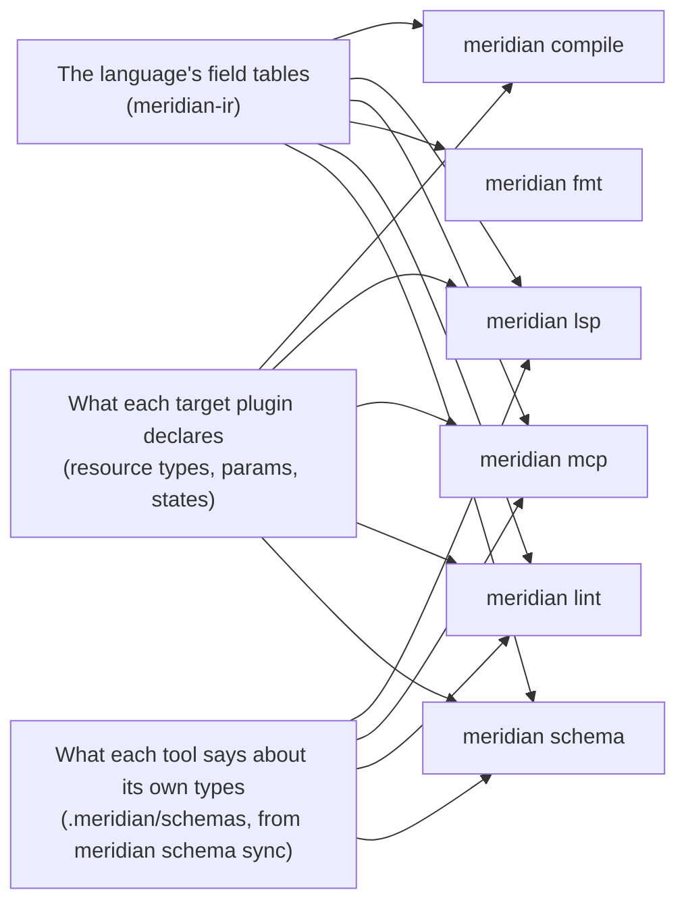

# Tools for writing Meridian documents

All in the `meridian` command:

| Tool | Command | What it is for |
|---|---|---|
| [Language server](language-server.md) | `meridian lsp` | completion, documentation, errors and navigation in your editor |
| [Visual Studio Code extension](vscode.md) | | the language server, set up for you in VS Code |
| [Other editors](other-editors.md) | | the same server in Neovim, Helix, Emacs and anything else that speaks the protocol |
| [Formatter](formatter.md) | `meridian fmt` | one standard layout, so diffs show changes and not taste |
| [Linter](linter.md) | `meridian lint` | the compiler's errors for a whole project, plus things that compile and are probably mistakes |
| [JSON Schema](json-schema.md) | `meridian schema` | validation in editors that only know YAML |
| [Tool schemas](schema-sync.md) | `meridian schema sync` | completion and checking of a tool's own types (`aws_instance`, `apps/v1/Deployment`), read once from the tool and cached |
| [Schema bundles](schema-bundles.md) | `meridian schema pack`, `sign`, `push`, `fetch` | the same schemas, signed and published to an OCI registry, so other machines and CI need no tool |
| [MCP server](mcp-server.md) | `meridian mcp` | the same compiler and catalogue as tools for an AI model, so a small model can write a document that compiles |

## They are the compiler

They share the compiler's descriptions:

- **Language fields** come from the parser's tables (completion, hover, field order, JSON
  Schema).
- **Resource types, params and states** come from installed plugins.
- **Tool types** (`aws_instance`, `apps/v1/Deployment`) come from
  [`meridian schema sync`](schema-sync.md).
- **Errors** come from `meridian validate` and each target's plugin, with nothing written
  or run.

An editor accepts exactly what `meridian compile` accepts.

## What a target describes

| Targets | What the tools know |
|---|---|
| ansible, puppet, openvox, chef, salt, cloud-init | Every resource type, every param with its meaning and kind, which are required, the states and the notify actions. An unknown param or state is an error in the editor. |
| terraform, opentofu, kubernetes, pulumi, dsc | The resource types by name or by shape (such as `<provider>_<type>`) from the plugin, and, once `meridian schema sync` has run, the tool's own types with every param, read from the tool itself: see [Tool schemas](schema-sync.md). Before a sync, params are not completed or checked in the editor. |
| cloudformation, bicep, arm, packer, docker, podman, helm | The resource types by name or by shape. Params belong to the tool's own providers and are not listed, so they are not completed or checked in the editor. The plugin still checks them when the document is compiled, and those errors are shown. |

See [Writing a plugin](../contributing/writing-a-plugin.md#describe-your-resource-types-for-editors).

## About the pictures

Monaco connected to a real `meridian lsp`;
[`tools/editor_screenshots`](../../tools/editor_screenshots/capture.js) regenerates them.
