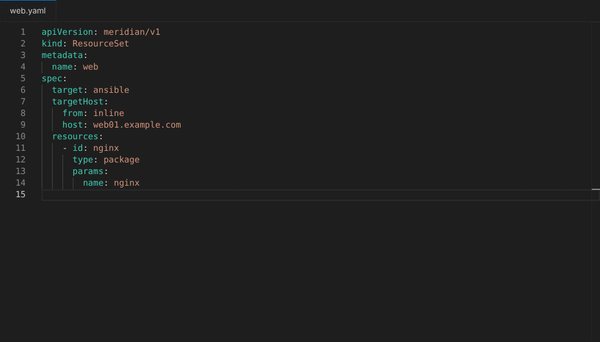
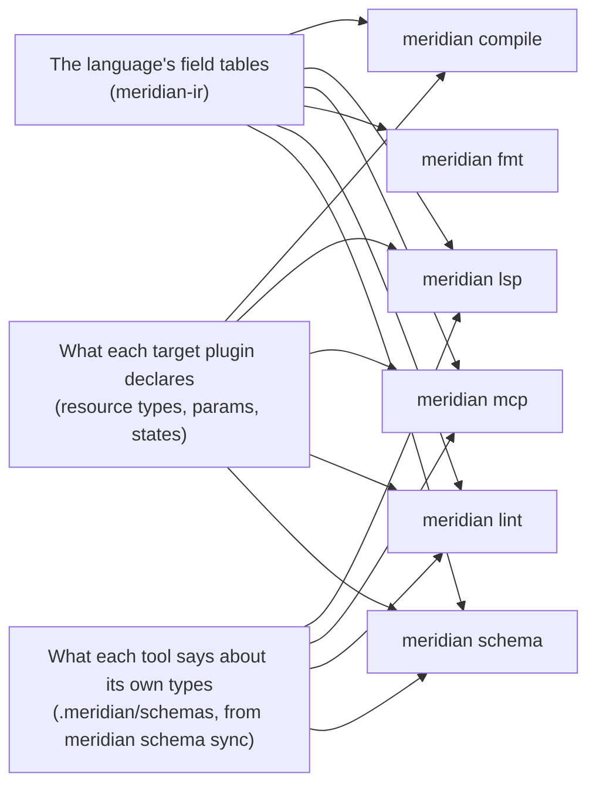

# Tools for writing Meridian documents

Meridian comes with the tools an author needs while writing, all in the one
`meridian` command:

| Tool | Command | What it is for |
|---|---|---|
| [Language server](language-server.md) | `meridian lsp` | completion, documentation, errors and navigation in your editor |
| [Visual Studio Code extension](vscode.md) | | the language server, set up for you in VS Code |
| [Other editors](other-editors.md) | | the same server in Neovim, Helix, Emacs and anything else that speaks the protocol |
| [Formatter](formatter.md) | `meridian fmt` | one standard layout, so diffs show changes and not taste |
| [Linter](linter.md) | `meridian lint` | the compiler's errors for a whole project, plus things that compile and are probably mistakes |
| [JSON Schema](json-schema.md) | `meridian schema` | validation in editors that only know YAML |
| [Tool schemas](schema-sync.md) | `meridian schema sync` | completion and checking of a tool's own types (`aws_instance`, `apps/v1/Deployment`), read once from the tool and cached |
| [Schema bundles](schema-bundles.md) | `meridian schema pack`, `sign`, `push`, `fetch` | the same schemas, signed and published to an OCI registry, so other machines and CI need no tool |
| [MCP server](mcp-server.md) | `meridian mcp` | the same compiler and catalogue as tools for an AI model, so a small model can write a document that compiles |

## They are the compiler

None of these tools has its own idea of the language. There is one description
of a document's fields, and one of each target's resource types, and everything
reads those:

- **The language's fields** (`apiVersion`, `kind`, `spec.resources`,
  `dependsOn`, and the rest) are listed once, in tables the parser itself
  reads to decide which fields a document may have. Completion, hover
  documentation, the formatter's field order and the JSON Schema are produced
  from the same tables. A field added to the language appears in every tool
  the moment the compiler accepts it.
- **Resource types, params and states** come from the target plugins. Each
  plugin says what it takes when it is loaded, and the tools ask the plugins
  you have installed. A plugin that is added or updated changes what your
  editor offers, with no change to the tools.
- **A tool's own types** (`aws_instance`, `apps/v1/Deployment`,
  `random:index:RandomPet`, `PSDscResources/Service`) come from the tool,
  through its plugin: `meridian schema sync` asks once and caches the answer
  in the project, and the editor tools read the cache. See
  [Tool schemas](schema-sync.md).
- **Errors** are the compiler's. The language server and the linter validate
  your documents with the same code as `meridian validate`, and then hand each
  one to its target's real plugin, exactly as `meridian compile` does, without
  writing any file or running any tool.

The result is that an editor never accepts what `meridian compile` refuses, and
never refuses what it accepts.

## What a target describes

How much the tools can say about a resource depends on how much its target
says about itself.

| Targets | What the tools know |
|---|---|
| ansible, puppet, openvox, chef, salt, cloud-init | Every resource type, every param with its meaning and kind, which are required, the states and the notify actions. An unknown param or state is an error in the editor. |
| terraform, opentofu, kubernetes, pulumi, dsc | The resource types by name or by shape (such as `<provider>_<type>`) from the plugin, and, once `meridian schema sync` has run, the tool's own types with every param, read from the tool itself: see [Tool schemas](schema-sync.md). Before a sync, params are not completed or checked in the editor. |
| cloudformation, bicep, arm, packer, docker, podman, helm | The resource types by name or by shape. Params belong to the tool's own providers and are not listed, so they are not completed or checked in the editor. The plugin still checks them when the document is compiled, and those errors are shown. |

A plugin author adds descriptions with one method; see
[Writing a plugin](../contributing/writing-a-plugin.md#describe-your-resource-types-for-editors).

## About the pictures

The pictures in these pages show the Monaco editor, the editor Visual Studio
Code is built on, connected to a real `meridian lsp` with the real plugins.
Everything in them is what the server answered.
[`tools/editor_screenshots`](../../tools/editor_screenshots/capture.js)
produces them again after a change.
