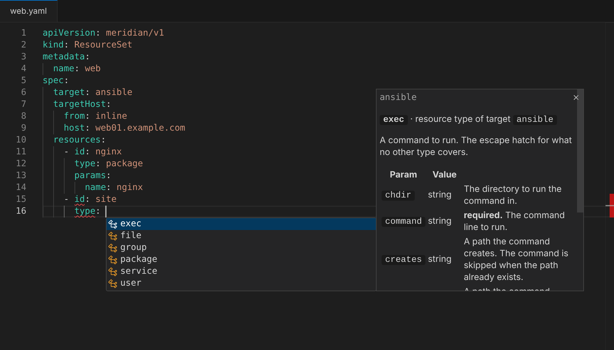
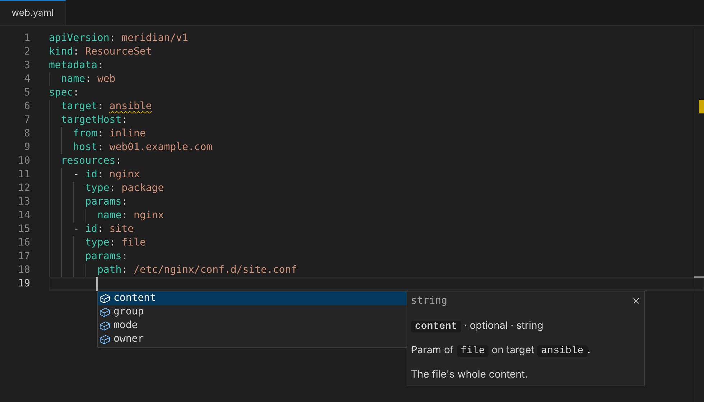
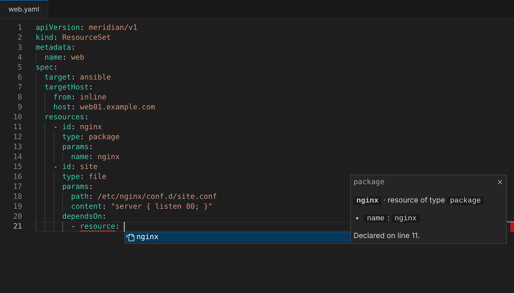
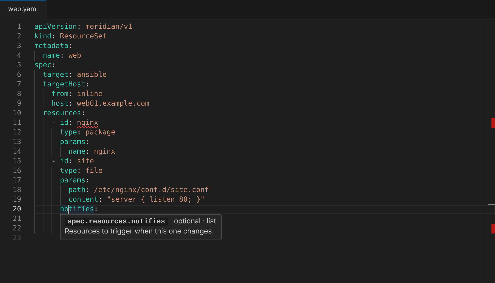
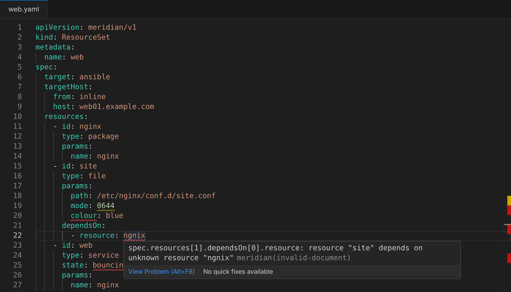

# The language server

`meridian lsp` is a [Language Server Protocol](https://microsoft.github.io/language-server-protocol/)
server on stdin and stdout. It never runs a tool or changes a file on its own.

- In Visual Studio Code, install [the extension](vscode.md).
- In another editor, see [Other editors](other-editors.md).

It serves YAML and JSON files whose `apiVersion` starts with `meridian/` and ignores the
rest.

## Completion

What can be written at the cursor, in language order:

| Where | What is offered |
|---|---|
| An empty file | a whole `Infrastructure` or `ResourceSet` document to start from |
| A mapping (`metadata`, `spec`, a resource, a `dependsOn` entry, ...) | the fields it may have and does not have yet, required fields marked |
| `apiVersion`, `kind`, `ifMissing`, `from`, and other fields with fixed values | the values, each with what it means |
| `spec.target` | the targets of the plugins you have installed that take this kind of document |
| `spec.targetVersion` | the versions the target says it compiles for |
| A resource's `type` | the target's resource types |
| A resource's `state` | the states that type takes on that target |
| Under a resource's `params` | the params that type takes on that target, required ones first, leaving out the ones already set; for a tool's own type, the params the [synced tool schema](schema-sync.md) lists, and inside a map param its nested params |
| A param with fixed values | the values |
| `dependsOn[].resource`, `notifies[].resource` | the ids of the other resources in the document |
| `notifies[].action` | the actions the notified resource's type takes |
| Inside `${...}` | the resources of the document, and after `resource.` the things that can be read from it: the outputs of an Infrastructure, and the params of the resource's type, including the ones the tool sets |
| Inside `${{ ... }}` | the [built-in functions](../reference/dsl/expressions.md) of the expression language, each inserted with its parentheses and shown with its signature and what it returns |
| `when` (on a document, a resource, an edge or an output) | `data.<key>` and `defined(...)`, and the names the document declares: `cond.<name>` from `spec.conditions`, `var.<name>` from `spec.variables`, `secret.<name>` from `spec.secrets` |
| An entry of `spec.imports` | its fields, and for `from` the two sources (`artifact`, `output`) |
| An entry of `spec.secrets` | its fields, `name` and `from` first, and for `from` the three sources (`env`, `file`, `exec`) |
| `targetHost.ref`, `targetHost.output` | the Infrastructure documents in the workspace, and the outputs the one named declares |

Types follow the document's `target`.

`params` opens a mapping, booleans offer `true` and `false`, and `mode` is inserted
quoted.

## Hover

Hover documents fields, targets, resource types (params and states), params (kind,
required, values, computed, sensitive, deprecated, nested), functions, choice values such
as `ifMissing: skip`, resource ids, and `targetHost.ref` and `.output`.

## Errors and warnings

Diagnostics appear as you type, from four sources:

| Source | Example | Where it comes from |
|---|---|---|
| The parser | `syntax`, `invalid-document` | the same code as `meridian validate`: YAML that does not parse, a field that does not exist, a value of the wrong kind, a dependency on a resource that does not exist, a cycle |
| The target's description | `unknown-target`, `kind-does-not-fit-target`, `unsupported-target-version`, `unsupported-resource-type`, `unsupported-param`, `unsupported-state`, `unsupported-value`, `unsupported-action`, `missing-param`, `wrong-param-kind`, `computed-param` | what the plugin says it takes, and what the [synced tool schemas](schema-sync.md) say about the tool's own types, checked resource by resource and param by param, nested params included, so that every problem is shown at once and in its place. On a target whose own types are any word, such as Puppet, Chef and cloud-init, a misspelt type is not caught here but by the compiler (see [decision 0032](../decisions/0032-native-types-beside-the-six-and-a-prefix-for-colliding-names.md)) |
| The target's compiler | whatever the plugin refuses, such as `unsupported-runtime-condition`, and `target-warning` for what it warns about | the document is compiled by the real plugin, in memory; nothing is written |
| The linter | `unquoted-mode`, `literal-secret`, ... | [the lint rules](../reference/lint.md); turn them off with the `lint` option |

Differences from `meridian compile`:

- **No data.** Handled as in [the linter](linter.md#conditions-and-data).
- **No secrets fetched.**
- **`kind: Module` is ignored.**
- **A missing plugin** gives one `unknown-target` error; with no plugins at all, targets are
  not reported.

Other workspace files are read for `targetHost` references; otherwise each file stands
alone.

## Quick fixes

Quoting a file mode is offered as a quick fix.

## Navigation

| Request | What it does |
|---|---|
| Go to definition | from a resource id in `dependsOn`, `notifies` or `${...}` to the resource; from `targetHost.ref` to the Infrastructure document, and from `targetHost.output` to the output, in whichever file they are |
| Find references | every place in the document a resource is named: its `id`, and each `dependsOn`, `notifies` and `${...}` that names it |
| Rename | renames a resource id and every `dependsOn`, `notifies` and `${...}` in the document that names it |
| Document symbols | the outline: each document, its resources and its outputs |

## Formatting

Format Document runs [`meridian fmt`](formatter.md); unparseable files are left alone.

## Options

Passed in `initializationOptions`.

| Option | Default | Meaning |
|---|---|---|
| `pluginDirs` | `[]` | directories to load plugins from, searched before the ones on the command line |
| `lint` | `true` | include the linter's findings in the diagnostics |
| `sortFields` | `true` | when formatting, write fields in the language's own order |
| `stateDir` | `.meridian` | where each workspace folder's [synced tool schemas](schema-sync.md) are read from, relative to the folder |

Plugins are found in `pluginDirs`, `--plugin-dir`, `MERIDIAN_PLUGIN_DIR`, then `meridian`'s
directory. A failed plugin is warned about once.

### Plugin signatures

[Plugin signatures](../reference/plugin-signatures.md) are checked as for every command
(`--plugin-signatures`, `--trusted-key`, or their environment variables).

Plugins in `pluginDirs` start only if signed by a trusted key, since projects can ship
editor settings. `--trust-editor-plugin-dirs` (or
`MERIDIAN_LSP_TRUST_EDITOR_PLUGIN_DIRS=true`) applies the normal policy instead.

After installing a plugin, run `meridian.reloadPlugins` (**Meridian: Reload Target
Plugins**) or restart.

Cached tool schemas are reread when they change; the server never syncs. A cache that
differs from `meridian.lock` gives one message.

## What the server supports

Full-document sync, UTF-16 positions, `textDocument/completion`,
`hover`, `definition`, `references`, `prepareRename`, `rename`,
`documentSymbol`, `formatting` and `codeAction` (kind `quickfix`),
`workspace/executeCommand` for `meridian.reloadPlugins`, and publishes
`textDocument/publishDiagnostics`.
