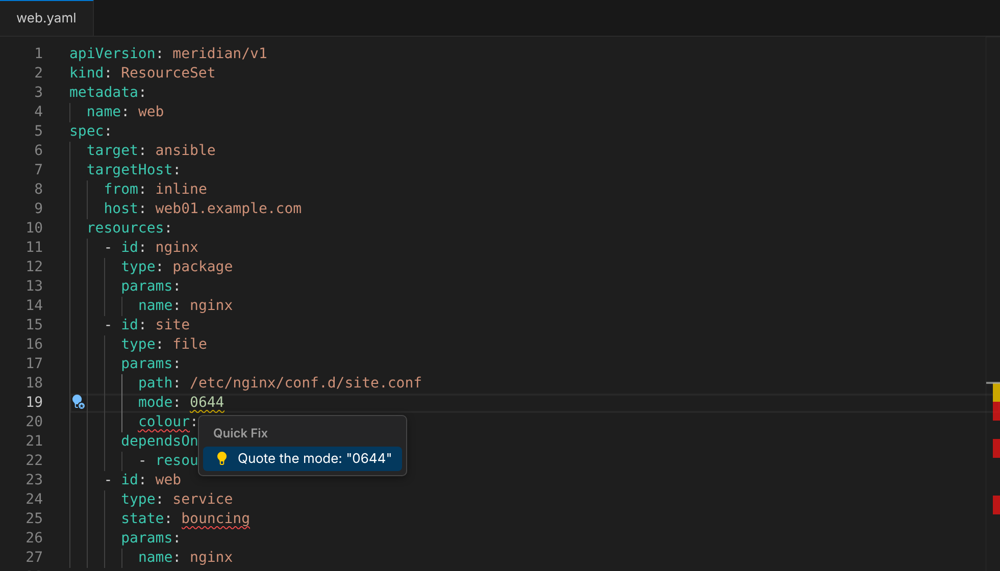

# The language server

`meridian lsp` is a [Language Server Protocol](https://microsoft.github.io/language-server-protocol/)
server. An editor starts it, sends it the files you have open, and shows what
it answers. It reads and writes standard input and output, and it never runs a
tool or changes a file on its own.

- In Visual Studio Code, install [the extension](vscode.md).
- In another editor, see [Other editors](other-editors.md).

It serves any YAML or JSON file with an `apiVersion` that starts with
`meridian/`. Other files are ignored, so it can be attached to every YAML file
without getting in the way.

## Completion

The server offers what can be written at the cursor, in the order the language
lists it, with its documentation.

| Where | What is offered |
|---|---|
| An empty file | a whole `Infrastructure` or `ResourceSet` document to start from |
| A mapping (`metadata`, `spec`, a resource, a `dependsOn` entry, ...) | the fields it may have and does not have yet, required fields marked |
| `apiVersion`, `kind`, `ifMissing`, `from`, and other fields with fixed values | the values, each with what it means |
| `spec.target` | the targets of the plugins you have installed that take this kind of document |
| `spec.targetVersion` | the versions the target says it compiles for |
| A resource's `type` | the target's resource types |
| A resource's `state` | the states that type takes on that target |
| Under a resource's `params` | the params that type takes on that target, required ones first, leaving out the ones already set |
| A param with fixed values | the values |
| `dependsOn[].resource`, `notifies[].resource` | the ids of the other resources in the document |
| `notifies[].action` | the actions the notified resource's type takes |
| Inside `${...}` | the resources of the document, and after `resource.` the things that can be read from it |
| `when` (on a document, a resource, an edge or an output) | `data.<key>` and `defined(...)`, and the names the document declares: `cond.<name>` from `spec.conditions`, `var.<name>` from `spec.variables`, `secret.<name>` from `spec.secrets` |
| An entry of `spec.imports` | its fields, and for `from` the two sources (`artifact`, `output`) |
| An entry of `spec.secrets` | its fields, `name` and `from` first, and for `from` the three sources (`env`, `file`, `exec`) |
| `targetHost.ref`, `targetHost.output` | the Infrastructure documents in the workspace, and the outputs the one named declares |

Resource types come from the target the document names. Change `target` from
`ansible` to `terraform` and the list changes with it.

A field is inserted with what usually follows it: `params` opens a mapping, a
boolean param offers `true` and `false`, and `mode` is inserted quoted so that
YAML does not read it as a number.

## Hover

Hovering shows the documentation of what is under the pointer:

- a field of the language: its path, whether it is required, what it holds;
- a target: its category, what it can do, the versions it compiles for;
- a resource type: its description and a table of its params and states on
  this target;
- a param: its kind, whether it is required, the values it takes;
- a value with a fixed set of choices, such as `ifMissing: skip`: what the
  choice means;
- a resource id in `dependsOn`, `notifies` or `${...}`: the resource it names;
- `targetHost.ref` and `targetHost.output`: the Infrastructure document and
  its outputs, or the output and its value.

## Errors and warnings

Diagnostics appear as you type, for every Meridian file you have open. They
come from four places, and each says which in its code:

| Source | Example | Where it comes from |
|---|---|---|
| The parser | `syntax`, `invalid-document` | the same code as `meridian validate`: YAML that does not parse, a field that does not exist, a value of the wrong kind, a dependency on a resource that does not exist, a cycle |
| The target's description | `unknown-target`, `kind-does-not-fit-target`, `unsupported-target-version`, `unsupported-resource-type`, `unsupported-param`, `unsupported-state`, `unsupported-value`, `unsupported-action`, `missing-param` | what the plugin says it takes, checked resource by resource so that every problem is shown at once and in its place |
| The target's compiler | whatever the plugin refuses, such as `unsupported-runtime-condition`, and `target-warning` for what it warns about | the document is compiled by the real plugin, in memory; nothing is written |
| The linter | `unquoted-mode`, `literal-secret`, ... | [the lint rules](../reference/lint.md); turn them off with the `lint` option |

Two things are different from `meridian compile`, both because an editor has
less to go on:

- **Conditions and interpolation.** The server is given no `--data` files. A
  document that needs none (its conditions and `${{ ... }}` read only
  `spec.variables` and literals) is worked out and compiled exactly as
  `meridian compile` would. A document that needs data is checked with every
  `when` treated as true, and if it interpolates values it is checked against
  the language only and not handed to the plugin, because the values are not
  known. A condition that is not written correctly is still reported. See
  [conditions and data](linter.md#conditions-and-data).
- **Secrets.** Neither the server nor `meridian lint` ever fetches a secret:
  no environment variable is read, no file is opened and no `exec` command is
  run because a document was opened or checked.
- **Module manifests.** A `meridian.yaml` with `kind: Module` is not a
  document to compile, and the server says nothing about it.
- **A missing plugin.** A document whose target has no installed plugin gets
  one error on `spec.target` (`unknown-target`) that lists the targets that
  are installed, and is otherwise checked against the language only. When no
  plugin is installed at all, nothing is said about targets, so the language
  is still checked on a machine that has only the `meridian` binary.

Documents in other files of the workspace are read too, so a ResourceSet whose
`targetHost` refers to an Infrastructure in another file is checked against it.
Each file is otherwise checked on its own: two files that both define a
document called `web` are two projects, not a mistake.

## Quick fixes

Where a problem has one safe fix, the server offers it as a quick fix. At
present that is quoting a file mode.

## Navigation

| Request | What it does |
|---|---|
| Go to definition | from a resource id in `dependsOn`, `notifies` or `${...}` to the resource; from `targetHost.ref` to the Infrastructure document, and from `targetHost.output` to the output, in whichever file they are |
| Find references | every place in the document a resource is named: its `id`, and each `dependsOn`, `notifies` and `${...}` that names it |
| Rename | renames a resource id and every `dependsOn`, `notifies` and `${...}` in the document that names it |
| Document symbols | the outline: each document, its resources and its outputs |

## Formatting

Format Document runs [`meridian fmt`](formatter.md) on the file. If the file
does not parse it is left alone and the error is shown as a diagnostic.

## Options

The editor passes these in `initializationOptions` when it starts the server.

| Option | Default | Meaning |
|---|---|---|
| `pluginDirs` | `[]` | directories to load plugins from, searched before the ones on the command line |
| `lint` | `true` | include the linter's findings in the diagnostics |
| `sortFields` | `true` | when formatting, write fields in the language's own order |

Plugins are looked for, in order, in `pluginDirs`, in each `--plugin-dir` given
to `meridian lsp` and in `MERIDIAN_PLUGIN_DIR`, and in the directory the
`meridian` binary is in. A plugin that fails to load is reported once as a
warning and the rest are used.

The server loads plugins when it starts. After installing or rebuilding one,
run the `meridian.reloadPlugins` command (in VS Code, **Meridian: Reload Target
Plugins**) or restart the server.

## What the server supports

For anyone connecting an editor by hand: the server uses full-document
synchronisation and UTF-16 positions, and answers `textDocument/completion`,
`hover`, `definition`, `references`, `prepareRename`, `rename`,
`documentSymbol`, `formatting` and `codeAction` (kind `quickfix`),
`workspace/executeCommand` for `meridian.reloadPlugins`, and publishes
`textDocument/publishDiagnostics`.
