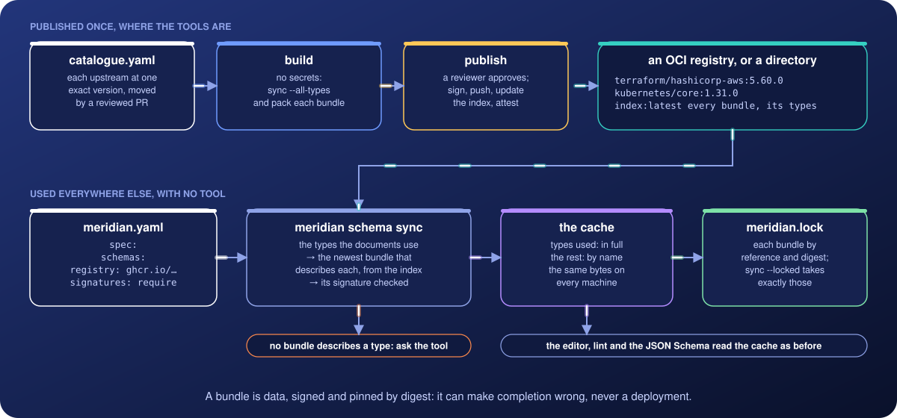

# Schema bundles: tool schemas without the tool

```
meridian schema sync   <paths>... [--prefer bundles|tool] [--locked] [--schema-signatures POLICY]
meridian schema update <paths>... [--target TARGET]
meridian schema fetch  <oci://REGISTRY/TARGET/NAME:VERSION | FILE> [PATHS]... [--no-lock] [--credential NAME] [--insecure]
meridian schema pack   <target> --name NAME --version VERSION [--prefix TEXT]... [--key FILE] [--out FILE]
meridian schema sign   <file> --key FILE [--out FILE]
meridian schema push   <file> <REGISTRY> [--credential NAME] [--insecure] [--no-index]
```

A **schema bundle** is the output of a [`meridian schema sync`](schema-sync.md), packed, signed
and published to an OCI registry, so other machines get the same schemas with no tool
installed.

For a project that takes its schemas from a registry:

```yaml
# meridian.yaml
apiVersion: meridian/v1
kind: Module
metadata:
  name: estate
spec:
  schemas:
    registry: ghcr.io/zanattamichael/meridian-schemas
    signatures: require
```

```console
$ meridian schema sync --trusted-key meridian-schemas.pub .
terraform: cached 1503 resource types from the schema bundle terraform/hashicorp-aws:5.60.0 in .meridian/schemas/terraform.json
kubernetes: cached 612 resource types from the schema bundle kubernetes/core:1.31.0 in .meridian/schemas/kubernetes.json
ansible: no schema bundle describes acme.internal.deploy; asking the tool
ansible: asking the tool about 3 resources in 1 document
ansible: cached 2 resource types from ansible-core 2.17.6; ansible.builtin 2.17.6 in .meridian/schemas/ansible.json
recorded in meridian.lock
```

Commit `meridian.lock`; every other machine and CI run does:

```console
$ meridian schema sync --locked .
```

and gets the same cache, byte for byte.

The registry above is the proposed [global repository](#publishing-the-global-repository) and
is not running yet. Any registry or directory works.

## What a bundle is

One target's schemas at one set of pins (such as `hashicorp/aws` `5.60.0`), named
`<target>/<name>:<version>`:

| Example | What it holds |
|---|---|
| `terraform/hashicorp-aws:5.60.0` | every resource, data source and ephemeral type of one provider at one version |
| `pulumi/aws:6.45.0` | every resource and function of one Pulumi package |
| `kubernetes/core:1.31.0` | every kind a Kubernetes 1.31 API server serves |
| `ansible/community.general:9.5.0` | every module of one collection |
| `cloudformation/us-east-1:2026-11-16` | the region's registry of resource types, as CloudFormation published it that day |
| `bicep/az:2026-11-16` | the Azure type definitions, as `bicep-types-az` stood that day |

Without a vendor version, the version is the read date. Contents (gzipped tar):

```
bundle.json           the header (target, name, version, tool, pins) and an
                      index: one line per type, with its description
types/<hash>.json     one type's full schema each, in the same model as the
                      plugin's own types and the cache
meridian.sig          the publisher's signature, when signed
```

Type files are read only when needed; the cache gets used types in full and the rest
[by name](schema-sync.md#described-in-full-or-by-name).

In a registry, a bundle is artifact type `application/vnd.meridian.schema-bundle.v1` (layer
`application/vnd.meridian.schema-bundle.layer.v1.tar+gzip`) at
`<registry>/<target>/<name>:<version>`. Each registry has an **index** at
`<registry>/index:latest` (`application/vnd.meridian.schema-index.v1`) listing every bundle's
pins, digest and type names.

A directory works the same way, for mirrors or offline machines:

```
schemas-mirror/
  index.json
  terraform/hashicorp-aws/5.60.0.tar.gz
  kubernetes/core/1.31.0.tar.gz
```

## Naming the registries: `spec.schemas`

In `meridian.yaml`:

```yaml
spec:
  schemas:
    registry: ghcr.io/zanattamichael/meridian-schemas   # looked in first
    signatures: require                                 # off | warn | require
    registries:                                         # then each of these, in order
      - registry: registry.example.com/platform/schemas
        credential: internal                            # from spec.credentials
      - registry: file://vendor/schemas                 # relative to the project
```

| Field | Meaning |
|---|---|
| `registry` | an OCI repository prefix with no scheme and no tag (`oci://` may be written), or `file://DIR` |
| `credential` | a credential from [`spec.credentials`](../reference/modules.md#registry-logins) to log in with; without one, the login `docker login` stored for the host is used, if any |
| `insecure` | `true` talks plain HTTP, for a registry on a trusted network only |
| `signatures` | `off` (do not look), `warn` (use an unsigned or wrongly signed bundle and say so) or `require` (use only bundles signed by a trusted key). The command line's `--schema-signatures` wins over it; without either it is `off`, as for modules |
| `registries` | more registries, each with its own `registry`, `credential` and `insecure`, looked in after `registry` |

Without `spec.schemas`, schemas come from the tools.

## How a sync chooses bundles

For each target, `meridian schema sync`:

1. takes the types the documents use, minus those the plugin describes;
2. keeps locked bundles (by digest) that still describe a used type;
3. for each remaining type, takes the **newest** bundle from the first registry whose index
   lists it;
4. checks signatures, writes the cache, and locks each bundle by reference and digest.

If any type has no bundle, or a registry cannot be read, the whole target is asked of its
tool, with a message saying why. Several bundles can serve one target.

`--prefer tool` (or `MERIDIAN_SCHEMA_PREFER=tool`) skips bundles.

## The lock file

The lock records the bundles:

```yaml
schemas:
  - target: terraform
    tool: terraform
    toolVersion: "1.13.1"
    pins:
      registry.terraform.io/hashicorp/aws: "5.60.0"
    integrity: h1:5c0e...
    bundles:
      - reference: oci+ghcr.io/zanattamichael/meridian-schemas/terraform/hashicorp-aws:5.60.0
        digest: sha256:9a1f...
```

| Field | Meaning |
|---|---|
| `bundles[].reference` | where the bundle came from: `oci+<registry>/<target>/<name>:<version>`, or `file+<path>` for a packed file |
| `bundles[].digest` | the OCI manifest's digest (for a file, the archive's), which is what a later fetch asks for |
| `integrity` | the hash of the cache file, as for a sync from the tool |

Bundle caches hold no timestamp, so `integrity` matches on every machine.

| Command | Does |
|---|---|
| `meridian schema sync .` | keeps the pinned bundles while they still describe the documents' types, and adds bundles for types they do not |
| `meridian schema sync --locked .` | uses exactly the bundles the lock pins, by digest, or fails; for a target synced from its tool, holds the tool to the version and pins the lock records. Nothing new is chosen |
| `meridian schema update .` | chooses again, from the indexes, the newest bundles that describe the documents' types, and moves the lock to them |
| `meridian schema sync --check .` | changes nothing and fetches nothing; fails if a cache is missing or is not what the lock records |

Fetched bundles are kept by digest under `.meridian/schemas/bundles/`.

## Signatures

Signed with the same keys as plugins and modules:

```console
$ meridian signing keygen --secret schemas.key --public schemas.pub
$ meridian schema pack terraform --name hashicorp-aws --version 5.60.0 --key schemas.key
```

or after packing:

```console
$ meridian schema sign terraform-hashicorp-aws-5.60.0.tar.gz --key schemas.key
signed terraform/hashicorp-aws:5.60.0 with key 3f2a9c1e5b3d8f6a into terraform-hashicorp-aws-5.60.0.tar.gz
  digest:  sha256:9a1f...
```

The signature covers target, name, version and content hash under
`meridian-schema-bundle-statement-v1`, so it cannot pass for another bundle, module or plugin.
Trust keys with `--trusted-key` (or `MERIDIAN_TRUSTED_KEYS`); set strictness with
`spec.schemas.signatures` or `--schema-signatures`:

| Policy | An unsigned bundle | A bundle whose signature does not pass |
|---|---|---|
| `off` | used | used |
| `warn` | used, with a warning | used, with a warning |
| `require` | refused, and nothing is written | refused, and nothing is written |

The lock records digests, not signers
([decision 0014](../decisions/0014-lock-file-does-not-record-the-signer.md)).

## What a bundle may hold

- Plain files only, at most 256 MiB unpacked, no links or escaping paths.
- `bundle.json` format 1 with exactly the listed fields; newer formats are refused.
- Each index entry points at its type's hashed file, which describes only that type.
- Type files at most 8 MiB, params nested at most 32 deep.
- Nothing is run.

A bad bundle can mislead completion and `lint`, never `compile` or apply.

## Making and publishing a bundle

Any team can publish bundles (private providers, collections, custom resources):

```console
$ meridian schema sync --all-types --prefer tool seed.yaml
terraform: asking the tool about 1 resource in 1 document
terraform: asking the tool again to describe all 1504 types in full
terraform: cached 1504 resource types from terraform 1.13.1; registry.terraform.io/acme/internal 2.1.0 in .meridian/schemas/terraform.json
$ meridian schema pack terraform --name acme-internal --version 2.1.0 \
    --prefix internal_ --prefix data.internal_ --key schemas.key
packed terraform/acme-internal:2.1.0 (212 resource types from terraform 1.13.1; registry.terraform.io/acme/internal 2.1.0) into .meridian/schemas/packed/terraform-acme-internal-2.1.0.tar.gz
  digest:  sha256:c4e1...
  signed:  key 3f2a9c1e5b3d8f6a
$ meridian schema push .meridian/schemas/packed/terraform-acme-internal-2.1.0.tar.gz \
    registry.example.com/platform/schemas --credential internal
published terraform/acme-internal:2.1.0 (212 resource types) to registry.example.com/platform/schemas
  reference: oci+registry.example.com/platform/schemas/terraform/acme-internal:2.1.0
  digest:    sha256:4b77...
  listed in the registry's index
```

| Step | Notes |
|---|---|
| `sync --all-types` | asks the tool twice: once for the documents' types, which lists every other type of the providers, packages or cluster in use by name, then again for all of them in full. A seed document that only names the provider (or package, or cluster) is enough. The cache can be large |
| `pack` | writes the target's cache as a bundle. `--name` and `--version` name it; `--prefix` keeps only the types whose names start with the text (one provider's, one collection's); `--key` signs it; `--out` says where (default `.meridian/schemas/packed/<target>-<name>-<version>.tar.gz`). It says how many types are only named, since a bundle is most use with each described |
| `sign` | signs a packed bundle, for a pipeline whose signing step is apart from its build |
| `push` | publishes to `<registry>/<target>/<name>:<version>` and lists the bundle in the registry's index. A version is published once: the same content again changes nothing, other content under the same version is refused. `--credential NAME` logs in with a credential from this directory's `meridian.yaml`; `--insecure` talks plain HTTP; `--no-index` leaves the index alone. A `file://DIR` registry is written the same way |

`meridian schema fetch` takes one bundle by reference or archive:

```console
$ meridian schema fetch oci://ghcr.io/zanattamichael/meridian-schemas/pulumi/aws:6.45.0 .
$ meridian schema fetch ./terraform-hashicorp-aws-5.60.0.tar.gz
```

With documents, used types are in full and others by name; without, all in full. It
replaces the target's cache, locks the bundle (unless `--no-lock`) and checks the signature.
Other registries take `--credential NAME` and `--insecure`.

## Publishing the global repository

Issue 165 proposes a weekly global repository. The template is
[`packaging/schema-registry/`](https://github.com/ZanattaMichael/meridian-core/tree/main/packaging/schema-registry),
to be copied into its own repository (`meridian-schemas`):

<p align="center"></p>

- **`catalogue.yaml`** pins each upstream: Terraform AWS, AzureRM and Google; Pulumi AWS,
  Azure Native and GCP; Kubernetes; CloudFormation `us-east-1`; Bicep's Azure types;
  `ansible.builtin` and `community.general`.
- **bump** (Mondays) opens one pull request moving the pins.
- **build** (no secrets) installs each tool, runs `sync --all-types` and `pack`, and
  summarises type and param changes.
- **publish** (after merge, behind the `schemas` environment's reviewer) signs, pushes,
  updates the index and attests provenance.

Owner decisions pending: repository name and owner, who holds the signing key, and the first
catalogue. See the template's README.

## In CI

```yaml
- run: meridian schema sync --locked --trusted-key keys/meridian-schemas.pub .
- run: meridian lint .
```

`--locked` fetches only what the lock pins.

## Limits

- Document version constraints (`version: "~> 5.60"`) are ignored when choosing; use
  `schema fetch` for a specific version.
- Custom resources, private providers and uncatalogued collections need the tool or a
  private registry.
- The index is unsigned; bundles are signed and digests locked.
- Vendor schema artifacts (such as Bicep's planned `mcr.microsoft.com/bicep/providers/az`)
  are not read yet.

See also: [Tool schemas](schema-sync.md), [Modules](../reference/modules.md) (OCI logins),
[decision 0041](../decisions/0041-tool-schemas-travel-as-signed-oci-bundles-chosen-by-the-types-the-documents-use.md).
